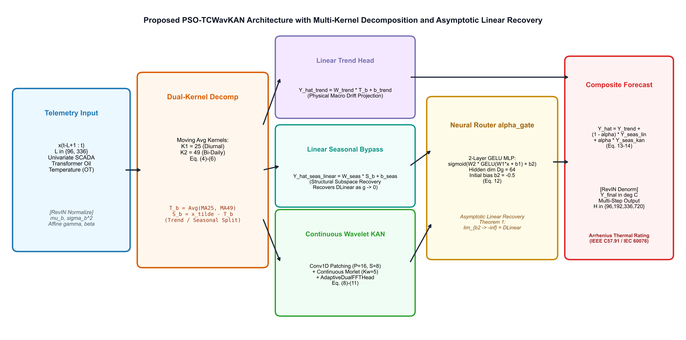
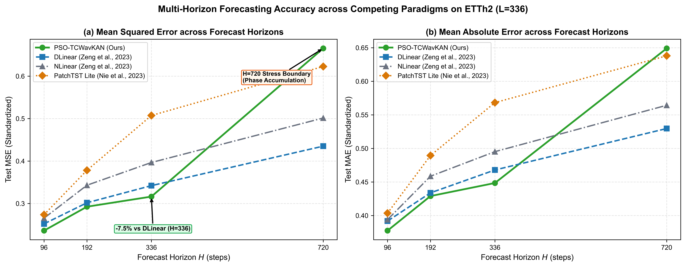

# PSO-TCWavKAN (v9.1): Swarm-Optimized Temporal Convolutional Wavelet Kolmogorov-Arnold Network for Resilient Power Transformer Thermal Dynamics Forecasting

[](https://www.python.org/)
[](https://pytorch.org/)
[](LICENSE)

**Official PyTorch implementation and benchmark result archive**

**Author:** [Nguyen Phu Toan](mailto:nphu211206@gmail.com)  
*Department of Information Technology, Hanoi University of Business and Technology, Hanoi, Vietnam*  
ORCID: [0009-0005-0529-2131](https://orcid.org/0009-0005-0529-2131)

---

## Executive Summary

High-voltage power transformers are capital-intensive grid assets. Their insulation aging is coupled to winding hot-spot temperature (HST) and top-oil temperature (OT); IEEE Std C57.91 and IEC 60076-7 describe an approximately doubled aging rate for each sustained 6 degrees C above the 110 degrees C reference. Accurate multi-step thermal forecasting therefore supports dynamic thermal rating, condition-based maintenance, and cooling control.

PSO-TCWavKAN replaces discrete B-spline knot adaptation with continuous dyadic Morlet wavelet filter banks, adds multi-kernel trend-seasonal decomposition and an instance-adaptive routing gate, and uses a bounded CLPSO warm-start before AdamW fine-tuning and Stochastic Weight Averaging (SWA).

The routing gate provides asymptotic linear structural recovery (Proposition 1): as the gate approaches zero, the hypothesis-space closure contains the multi-kernel linear subspace. This is a representational-containment statement, not an unconstrained optimization or test-generalization guarantee.

---

## Architecture



*Fig. 1: End-to-end workflow. Raw telemetry passes through Reversible Instance Normalization (RevIN), dual-kernel trend-seasonal decomposition (K1=25, K2=49), patch embedding, the continuous dyadic wavelet KAN block, the neural routing gate g(x), and the asymptotic linear-recovery combination.*

Core components:

1. **Continuous dyadic wavelet filter bank (Kw = 5 octaves).** Learnable Morlet-style responses replace piecewise B-spline knots, eliminating discontinuous grid-reallocation events.
2. **Multi-kernel trend-seasonal decomposition.** Two moving-average kernels (25 and 49) separate the diurnal cycle from multi-day thermal accumulation.
3. **Neural routing gate and Proposition 1.** The gate interpolates between a linear projection and the wavelet pathway; its zero-gate limit contains the multi-kernel linear subspace.
4. **CLPSO warm-start.** A constriction-factor CLPSO searches a bounded 4-D space: omega0 in [3.0, 8.0], raw scale q = log_scale in [-2.5, 0.0], logit_alpha in [-5.0, -2.0], and log10(lr) in [-3.0, -2.0]. The protocol uses 5 particles for 5 generations, i.e. exactly 25 surrogate evaluations. The initial population is evaluated in generation 1 and is not double-counted.
5. **Scale parameterization.** The searched quantity q is named `log_scale` in the code, but it is a raw parameter, not log10(s). The model computes the effective scale as `s = softplus(q) + 1e-4`, which maps the search interval to approximately [0.079, 0.693].

---

## Benchmark Results

Models were evaluated on ETTh1 and ETTh2 with lookbacks L in {96, 336} and horizons H in {96, 192, 336, 720}. DLinear, NLinear, and PSO-TCWavKAN use five seeds {1000, 2000, 3000, 4000, 5000}; PatchTST Lite uses three seeds {1000, 2000, 3000}. Values are mean test MSE / MAE on the standardized scale.

| Dataset | L | H | DLinear | NLinear | PatchTST Lite | **PSO-TCWavKAN** |
|:---|:---:|:---:|:---:|:---:|:---:|:---:|
| ETTh1 | 96 | 96 | 0.1121 / 0.2590 | **0.1106 / 0.2550** | 0.1110 / 0.2524 | 0.1127 / 0.2592 |
| ETTh1 | 96 | 192 | 0.1528 / 0.3026 | 0.1375 / 0.2860 | 0.1486 / 0.2939 | **0.1320 / 0.2799** |
| ETTh1 | 96 | 336 | **0.1464 / 0.2999** | 0.1459 / 0.2997 | 0.1480 / 0.3005 | 0.1500 / 0.3035 |
| ETTh1 | 96 | 720 | **0.1759 / 0.3329** | 0.2213 / 0.3734 | 0.2049 / 0.3574 | 0.2193 / 0.3695 |
| ETTh1 | 336 | 96 | 0.1086 / 0.2562 | 0.1031 / 0.2485 | **0.0987 / 0.2407** | 0.1002 / 0.2425 |
| ETTh1 | 336 | 192 | **0.1147 / 0.2660** | 0.1244 / 0.2748 | 0.1163 / 0.2648 | 0.1328 / 0.2842 |
| ETTh1 | 336 | 336 | 0.1572 / 0.3162 | 0.1789 / 0.3354 | 0.1614 / 0.3166 | **0.1325 / 0.2859** |
| ETTh1 | 336 | 720 | **0.1659 / 0.3234** | 0.2205 / 0.3699 | 0.2332 / 0.3873 | 0.1817 / 0.3404 |
| ETTh2 | 96 | 96 | 0.2806 / 0.4037 | 0.2756 / 0.3988 | 0.2744 / 0.4036 | **0.2630 / 0.3883** |
| ETTh2 | 96 | 192 | 0.3531 / 0.4634 | 0.3501 / 0.4596 | 0.3412 / 0.4592 | **0.3312 / 0.4501** |
| ETTh2 | 96 | 336 | 0.3854 / 0.4856 | 0.3607 / 0.4712 | 0.3545 / 0.4709 | **0.3527 / 0.4682** |
| ETTh2 | 96 | 720 | 0.5628 / 0.5952 | 0.5025 / 0.5630 | 0.5048 / 0.5694 | **0.4860 / 0.5575** |
| ETTh2 | 336 | 96 | 0.2520 / 0.3918 | 0.2654 / 0.3939 | 0.2735 / 0.4036 | **0.2360 / 0.3775** |
| ETTh2 | 336 | 192 | 0.3017 / 0.4338 | 0.3430 / 0.4586 | 0.3782 / 0.4894 | **0.2924 / 0.4290** |
| ETTh2 | 336 | 336 | 0.3420 / 0.4679 | 0.3966 / 0.4952 | 0.5073 / 0.5682 | **0.3162 / 0.4485** |
| ETTh2 | 336 | 720 | **0.4351 / 0.5296** | 0.5014 / 0.5643 | 0.6228 / 0.6379 | 0.6656 / 0.6491 |
| **Mean** | - | - | **0.2529 / 0.3830** | 0.2648 / 0.3904 | 0.2799 / 0.4010 | 0.2565 / 0.3833 |

**What the table supports.** PSO-TCWavKAN has the lowest MSE in 7 of 8 ETTh2 configurations, including a 13.6% reduction over DLinear at ETTh2 L=96, H=720. For L=96, the reductions at H=96/192/336 are 6.3%, 6.2%, and 8.5%; for L=336 they are 6.3%, 3.1%, 7.5%, and the model loses at H=720. Across all 16 conditions it wins 12/16 against NLinear, 10/16 against DLinear, and 10/16 against PatchTST Lite. Its overall mean MSE is 1.4% higher than DLinear because of the H=720 dispersion, and the DLinear comparison is not statistically significant.

**Statistical tests.** Two-sided Wilcoxon signed-rank tests across the 16 paired conditions give:
- vs NLinear: W=28.0, p=0.0386 (uncorrected), Holm-corrected p=0.116.
- vs DLinear: W=46.0, p=0.274.
- vs PatchTST Lite: W=35.0, p=0.0934.

After Holm correction, none of the three comparisons is significant at alpha=0.05. Using the 4-decimal table values gives W=29.0, p=0.0443, Holm p=0.133 for NLinear. Both variants are reported transparently; run `reproduce_statistical_tests.py` to print them.



*Fig. 7: Multi-horizon MSE/MAE trajectories on ETTh2 (L=336).*

---

## Ablation Study

The 80-cell matrix contains five variants across 16 configurations. A1-A4 were trained with three seeds per cell (192 training runs). A5 is not a separate three-seed ablation run: it references the five-seed benchmark mean from Table 4 / TABLE1_BENCHMARK_FINAL.csv. The A5 row in TABLE2_ABLATION_FINAL.csv is therefore benchmark-referenced; its seed columns show seeds 1000-3000 and its mean includes all five benchmark seeds.

| Variant | Modification | Mean MSE (H <= 336) | Delta vs A5 |
|:---|:---|:---:|:---:|
| A1 NoHarmonicBank | Single-frequency WavKAN (Kw=1) | 0.21783 | +2.44% |
| A2 NoMultiKernelDecomp | Single moving-average kernel (K=25) | 0.22247 | +4.62% |
| A3 NoNeuralRouter | Fixed gate g=0.5 | 0.21768 | +2.37% |
| A4 NoCLPSO | Random initialization | 0.21612 | +1.63% |
| **A5 Full** | Complete model | **0.21265** | **0.00%** |

The deltas are descriptive comparisons across different seed budgets, not a controlled significance test.

---

## Noise Diagnostic (Single-Checkpoint)

Table 6 is an exploratory mixed-source diagnostic, not a controlled multi-seed experiment:

- For ETTh1 (96,96), ETTh1 (336,720), and ETTh2 (96,192), the clean sigma=0.0 entries equal the five-seed benchmark means (0.1127, 0.1817, 0.3312). They are not Seed 1000 checkpoint values.
- For ETTh2 (336,336), all entries come from the pre-SWA Seed 1000 checkpoint (clean 0.3426). Its clean MSE is 8.3% above the post-SWA five-seed benchmark mean 0.3162.
- Noise columns are archived single-checkpoint observations. Per-seed noise trajectories are not included in this release.
- Because the clean and noise sources differ for the first three rows, the table reports raw MSE only. No within-checkpoint degradation ratio or multi-seed robustness claim is made; the one internally consistent row (ETTh2 336,336) rises from 0.3426 to 0.3475 at sigma=0.30 (+1.4%).

| Dataset | L | H | Clean ref. | Clean source | sigma=0.1 | sigma=0.2 | sigma=0.3 |
|:---|:---:|:---:|:---:|:---|:---:|:---:|:---:|
| ETTh1 | 96 | 96 | 0.1127 | Benchmark mean | 0.1145 | 0.1192 | 0.1273 |
| ETTh1 | 336 | 720 | 0.1817 | Benchmark mean | 0.2142 | 0.3216 | 0.4354 |
| ETTh2 | 96 | 192 | 0.3312 | Benchmark mean | 0.3334 | 0.3392 | 0.3472 |
| ETTh2 | 336 | 336 | 0.3426 | Pre-SWA Seed 1000 | 0.3432 | 0.3437 | 0.3475 |

---

## Computational Profile

| Model | Parameters (L=96,H=96) | Parameters (L=336,H=720) | Train time/epoch | Batch latency | Peak GPU memory |
|:---|:---:|:---:|:---:|:---:|:---:|
| DLinear | 18,624 | 485.3 K | 0.42 s | 1.1 ms | 412 MB |
| NLinear | 9,312 | 242.6 K | 0.45 s | 1.2 ms | 415 MB |
| PatchTST Lite | 169,570 | 1,993.8 K | 2.85 s | 8.6 ms | 1,240 MB |
| **PSO-TCWavKAN** | **44,841** | **796.9 K** | **1.24 s** | **3.4 ms** | **680 MB** |

Parameter counts are analytically reproducible with `reproduce_table7_params.py`. Train time, latency, and peak memory are observational measurements from the original Kaggle T4 run; the profiling script and raw logs are not archived in this release, so these values were not independently reproduced. The 3.4 ms latency and the 3.3x training-speedup claim refer to the standard B-spline KAN diagnostic (1.24 vs 4.15 s/epoch), not PatchTST Lite (2.85 s/epoch), and should be treated as original-run observations.

---

## Repository Structure

```
.
|-- figures/                                  # 600 DPI publication figures (Fig. 1-10)
|-- results/
|   |-- TABLE1_BENCHMARK_FINAL.csv            # 16-config benchmark matrix (64 rows)
|   |-- TABLE2_ABLATION_FINAL.csv             # 80-cell ablation matrix
|   `-- TABLE5_NOISE_ROBUSTNESS_FINAL.csv     # Noise diagnostic
|-- TABLE1_BENCHMARK_FINAL.csv                # Root copies of the result CSVs
|-- TABLE2_ABLATION_FINAL.csv
|-- TABLE5_NOISE_ROBUSTNESS_FINAL.csv
|-- pso_tcwavkan_v91.py                       # Model, CLPSO, training, evaluation, CLI
|-- reproduce_statistical_tests.py            # Wilcoxon + Holm reproduction
|-- reproduce_table7_params.py                 # Table 7 parameter-count reproduction
|-- plot_grid_dilemma_v2.py                    # Figure 3 B-spline diagnostic
|-- main.py                                   # Demo entry point
|-- requirements.txt
|-- LICENSE
`-- README.md
```

---

## Quick Start

### 1. Installation

```bash
git clone https://github.com/nphu211206/KAN-PSO-Transformer-Forecasting.git
cd KAN-PSO-Transformer-Forecasting
python -m venv venv
# Windows:
.\venv\Scripts\activate
# Linux/macOS:
source venv/bin/activate
pip install -r requirements.txt
```

### 2. Fast verification demo

```bash
python main.py
# or explicitly:
python pso_tcwavkan_v91.py --mode demo --dataset ETTh1 --lookback 96 --horizon 96 --epochs 5
```

The demo downloads ETTh1 if needed, runs a small CLPSO warm-start (3 particles x 2 generations), trains for a few epochs, and prints test MSE/MAE. It is a smoke test, not a paper result.

### 3. Paper sessions

The execution mode is selected at runtime; it is not hard-coded in the file.

```bash
# Main benchmark: DLinear, NLinear, PSO-TCWavKAN (16 configs x 5 seeds)
python pso_tcwavkan_v91.py --run_mode SESSION1

# PatchTST Lite baseline (16 configs x 3 seeds)
python pso_tcwavkan_v91.py --run_mode SESSION2A

# Ablations A1-A4 (three seeds each; A5 is taken from SESSION1)
python pso_tcwavkan_v91.py --run_mode SESSION2B1
python pso_tcwavkan_v91.py --run_mode SESSION2B2
python pso_tcwavkan_v91.py --run_mode SESSION2C

# Aggregate the session CSVs
python pso_tcwavkan_v91.py --run_mode MERGE

# Help
python pso_tcwavkan_v91.py --help
```

`--mode` is accepted as an alias for `--run_mode`, so `--mode SESSION1` also works.

### 4. Reproduce the statistical tests

```bash
python reproduce_statistical_tests.py --csv results/TABLE1_BENCHMARK_FINAL.csv
```

The script prints both the rounded Table 4 values (W=29.0, p=0.0443, Holm 0.1329 for NLinear) and the full-precision CSV values (W=28.0, p=0.0386, Holm 0.1159).

---

## Reproducibility Notes and Release Boundaries

- **CLPSO budget.** The code performs exactly 5 particles x 5 generations = 25 surrogate evaluations for the paper protocol. The loop asserts this count. The initial population is evaluated in generation 1 and is not counted twice.
- **Scale mapping.** The searched parameter is q = `log_scale`; the effective scale is `softplus(q) + 1e-4`. The bounds are expressed in q, not log10(s).
- **PatchTST Lite.** Patch length 16 and stride 8 are used for both L=96 and L=336 (50% overlap), matching the paper description and the code defaults.
- **Standard deviations.** MSE_std is the sample standard deviation (ddof=1), matching TABLE1_BENCHMARK_FINAL.csv.
- **A5 ablation provenance.** A5 is the five-seed benchmark mean, not a separate three-seed ablation run. A1-A4 use three seeds (192 runs). The A5 seed columns in TABLE2_ABLATION_FINAL.csv are copied from the benchmark CSV for seeds 1000-3000.
- **Figures 3, 5, 6, 9, and 10.** Fig. 3 is a B-spline diagnostic, not a head-to-head comparison with PSO-TCWavKAN. Figs. 5, 6, 9, and 10 are predecessor-checkpoint diagnostics (KAN_WOA_RegBestClip), not PSO-TCWavKAN v9.1 outputs. They are retained as context and boundary diagnostics.
- **Not included in this release.** Per-seed raw training logs, model checkpoints, per-seed noise trajectories, and the Table 7 profiling logs are not included. They were generated in Kaggle Cloud environments and are available from the author on reasonable request.
- **PatchTST scope.** PatchTST Lite is a lightweight adapted baseline, not the full unconstrained canonical PatchTST; it is not parameter-matched to PSO-TCWavKAN (169.6 K vs. 44.8 K at L=96/H=96).

---

## Data and Code Availability

- ETT datasets: https://github.com/zhouhaoyi/ETDataset
- This repository: https://github.com/nphu211206/KAN-PSO-Transformer-Forecasting
- License: MIT (see LICENSE)

---

## Citation

```bibtex
@misc{nguyen2026psotcwavkan,
  title={{PSO-TCWavKAN}: A Swarm-Optimized Temporal Convolutional Wavelet Kolmogorov-Arnold Network with Multi-Kernel Trend Decomposition and Asymptotic Linear Structural Recovery for Resilient Power Transformer Thermal Dynamics Forecasting},
  author={Nguyen, Phu Toan},
  year={2026},
  howpublished={Manuscript submitted to Electrical Engineering (Archiv fuer Elektrotechnik)},
  note={Code and data archive: https://github.com/nphu211206/KAN-PSO-Transformer-Forecasting}
}
```

---

## Acknowledgements

The ETT benchmark was introduced by Zhou et al. (AAAI 2021). Computational resources were provided by Kaggle Cloud NVIDIA Tesla T4 GPUs. The author thanks the open-source Python scientific community (NumPy, PyTorch, SciPy, Matplotlib, pandas).
