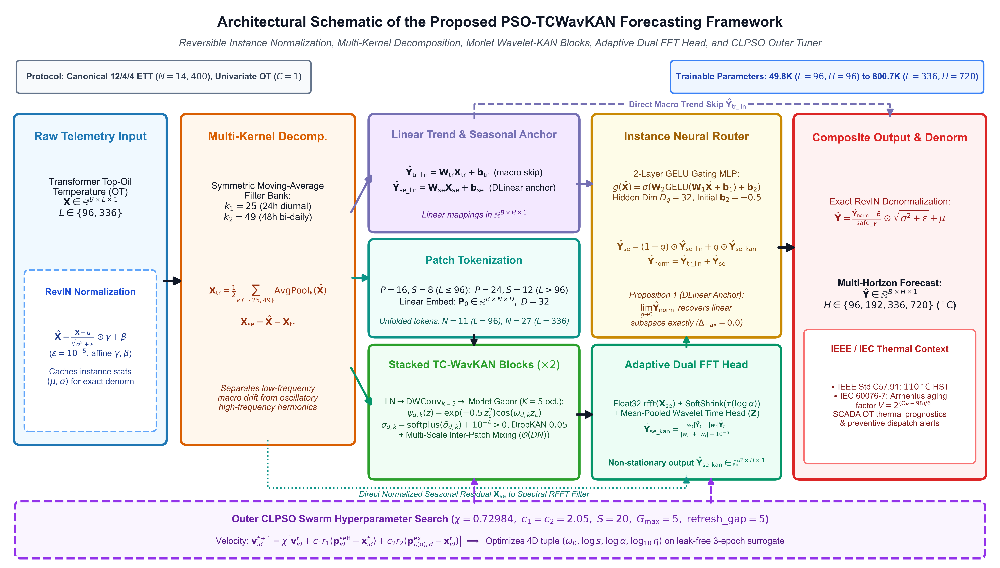
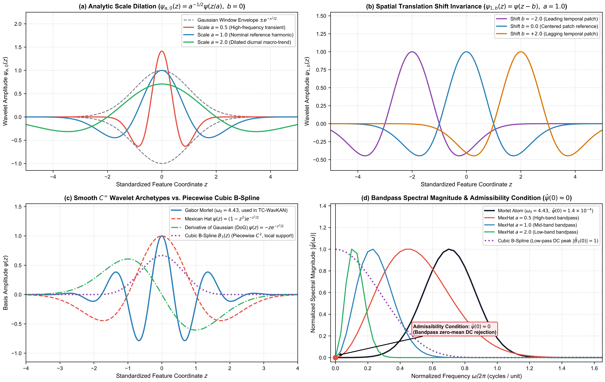
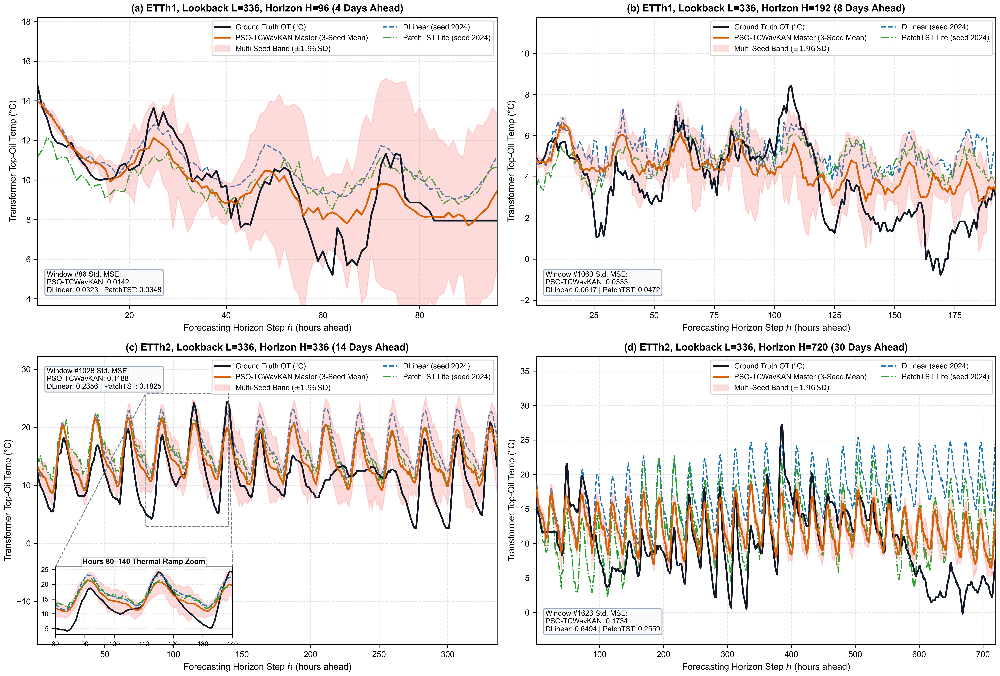
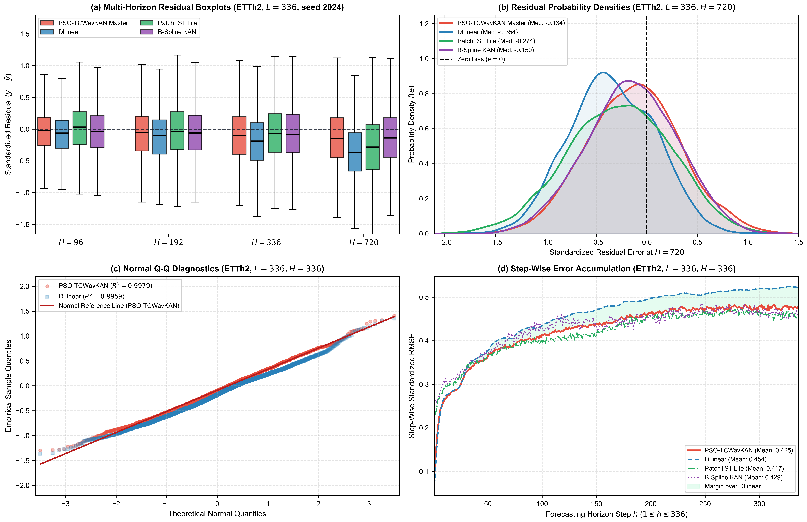
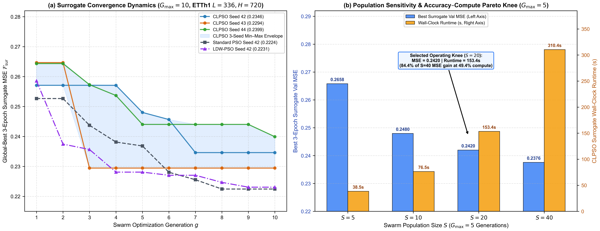
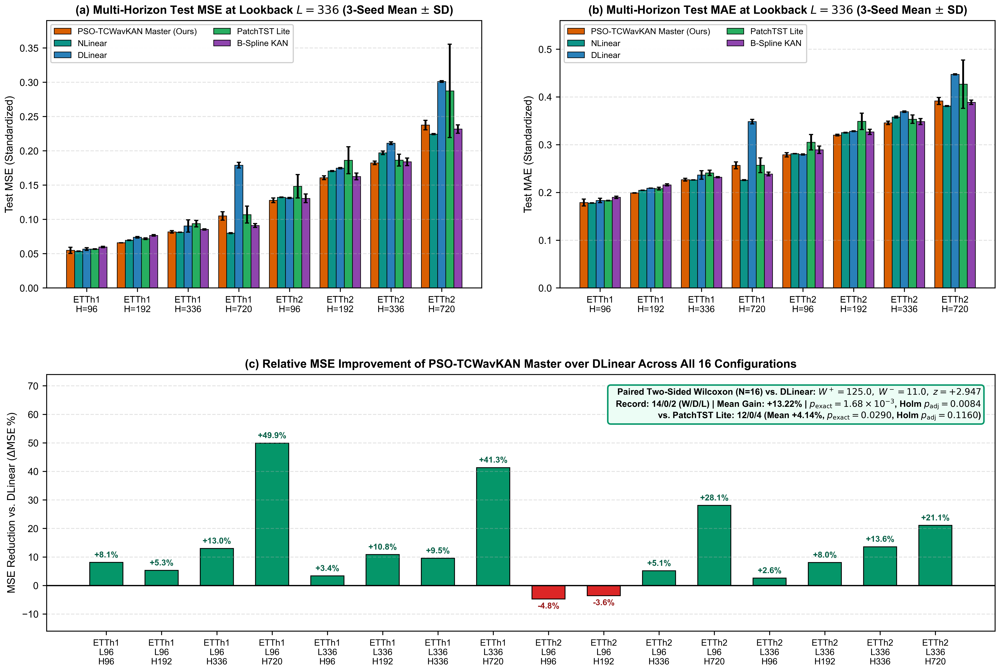

# PSO-TCWavKAN: Swarm-Optimized Temporal Continuous Wavelet Kolmogorov–Arnold Networks for Power Transformer Thermal Dynamics Forecasting

**Running Title:** PSO-TCWavKAN for Transformer Thermal Dynamics
**Author:** Phu Toan Nguyen
**Affiliation:** Faculty of Information Technology, Hanoi University of Business and Technology (HUBT), No. 29A, Lane 124, Vinh Tuy Street, Vinh Hung Ward, Hai Ba Trung District, Hanoi 100000, Vietnam
**Email:** nphu211206@gmail.com | **ORCID:** 0009-0005-0529-2131

---

## Abstract

Accurate forecasting of oil-immersed power transformer top-oil temperature (`OT`) is essential for monitoring cellulose insulation aging under IEEE Std C57.91-2011 and enabling Dynamic Thermal Rating in smart grids. However, existing long-term time series forecasting (LTSF) models face critical structural trade-offs: self-attention Transformers incur quadratic $\mathcal{O}(L^2)$ scaling and weak local phase sensitivity, linear mappings underfit multi-frequency thermal transients, and B-spline Kolmogorov–Arnold Networks (KAN) experience knot re-gridding momentum disruptions and boundary gradient collapse under non-stationary load shifts. We propose **PSO-TCWavKAN**, a hybrid framework coupling Invertible Reversible Instance Normalization (RevIN) with detached statistical moments, multi-kernel moving-average decomposition ($k \in \{25, 49\}$), patch-embedded continuous Morlet wavelet KAN blocks, depthwise separable inter-patch mixing, an adaptive dual Fast Fourier Transform (FFT) spectral head, and an instance-adaptive neural router. A Clerc-constrained Comprehensive Learning Particle Swarm Optimizer ($\chi = 0.72984$, $S=20$, $G_{\max}=5$) pre-optimizes four core wavelet and learning hyperparameters on a leak-free three-epoch validation proxy prior to cosine-annealed AdamW and Stochastic Weight Averaging fine-tuning. We prove non-degenerate asymptotic recovery of the linear decomposition subspace as gating vanishes (Proposition 1) and establish linear $\mathcal{O}(DN)$ backbone token-mixing complexity (Theorem 1). Across 16 canonical ETTh1 and ETTh2 `OT` configurations (three seeds), PSO-TCWavKAN reduces MSE by **13.22%** on average (up to 49.92%) over DLinear ($14/0/2$ wins; two-sided exact Wilcoxon $p = 1.68 \times 10^{-3}$, Holm-adjusted $p = 0.0084$) and outperforms PatchTST Lite on $12/16$ settings (+4.14%, $p = 0.0290$), while executing single-sample GPU inference in 3.61–3.88 ms.

**Keywords:** Kolmogorov–Arnold Networks (KAN); Continuous Morlet Wavelets; Particle Swarm Optimization; Power Transformer Thermal Dynamics; Reversible Instance Normalization; Long-Term Time Series Forecasting.

---

## 1. Introduction

### 1.1 Physical Stakes of Transformer Thermal Dynamics
Power transformers constitute pivotal capital assets across high-voltage transmission and distribution networks, where asset longevity directly determines grid stability and supply reliability [1–3]. For mineral-oil-immersed transformers, service lifetime is governed primarily by progressive thermodynamic and hydrolytic depolymerization of cellulose paper insulation wrapped around copper windings [4, 5]. Under IEEE Std C57.91-2011 [6] and IEC Std 60076-7:2018 [7], thermal stress is monitored via two operational state variables: the top-oil temperature (TOT, denoted `OT`) and the winding hottest-spot temperature (HST).

Grounded in the chemical reaction kinetics of Arrhenius [8] and Montsinger's thermal loading law [9], the relative insulation aging acceleration factor $V$ increases exponentially with hottest-spot temperature $\Theta_{\mathrm{HST}}$ ($^\circ\mathrm{C}$) relative to the $T_{\mathrm{ref}} = 110^\circ\mathrm{C}$ reference rating [6]:

$$V = \exp \left( \frac{E_A}{R \cdot (T_{\mathrm{ref}} + 273.15)} - \frac{E_A}{R \cdot (\Theta_{\mathrm{HST}} + 273.15)} \right) \qquad (Eq. 1)$$

where $E_A \approx 111\text{ kJ/mol}$ is the cellulose activation energy and $R = 8.314\text{ J/(mol}\cdot\text{K)}$ is the universal gas constant. Consequently, sustained thermal excursions of $6\text{--}10^\circ\mathrm{C}$ above rated thresholds approximately double cumulative insulation aging rates, risking paper embrittlement, oil dielectric degradation, and unscheduled outages [10, 11]. Multi-horizon forecasting of top-oil thermal trajectories across $H \in [96, 720]$ hours (4–30 days) therefore empowers utilities to implement Dynamic Thermal Rating (DTR) [1], schedule preventive maintenance, and avoid irreversible dielectric stress.

### 1.2 Critique of Existing Long-Term Time Series Forecasting Paradigms
Long-term time series forecasting (LTSF) has progressed rapidly through Transformer [12, 13], convolutional [14, 15], frequency-domain [16, 17], and foundation-model architectures [18]. Nevertheless, applying existing LTSF models to continuous power transformer SCADA telemetry exposes three structural bottlenecks:

1. **Attention Scaling and Temporal Permutation Fragility**: Canonical dot-product self-attention architectures [19, 20] incur $\mathcal{O}(L^2)$ time and memory complexity with respect to lookback length $L$. Although sparse and low-rank approximations—including Reformer [21], Linformer [22], FEDformer [23], Crossformer [24], and PatchTST [25]—alleviate quadratic bottlenecks, Zeng et al. [26] demonstrated that permutation-invariant global attention frequently under-exploits fine-grained causal ordering in smooth physical time series.
2. **Capacity Limits in Pure Linear Mappings**: Embarrassingly simple trend-seasonal linear predictors such as DLinear and shift-normalized NLinear [26] achieve competitive accuracy on steady diurnal patterns and minimal compute overhead. However, a single static linear projection cannot capture nonlinear convective heat-transfer coupling between volatile load switching and ambient thermal inertia [4, 27].
3. **Distribution Shift and Inverse Scaling Instability**: Industrial load cycles introduce severe mean and variance shifts between historical training segments and future test regimes. Reversible Instance Normalization (RevIN) [28] mitigates cross-window shift, yet naive implementations risk autograd leakage through instance moments or numerical ill-conditioning if learned affine scale parameters vanish during inverse denormalization.

### 1.3 Kolmogorov–Arnold Networks and the B-Spline Grid Update Dilemma
Classical multilayer perceptrons (MLPs) rely on universal approximation via affine projections followed by fixed node nonlinearities [29, 30]. Inspired by the Kolmogorov–Arnold superposition theorem [31, 32], Liu et al. [33] introduced Kolmogorov–Arnold Networks (KANs), relocating learnable univariate activations onto computational edges:

$$f(\mathbf{x}) = \sum_{q=1}^{2n+1} \Phi_q \left( \sum_{p=1}^n \phi_{q,p}(x_p) \right), \quad \phi_{\mathrm{spline}}(x) = w_b \operatorname{SiLU}(x) + \sum_{i=1}^G c_i B_i(x) \qquad (Eq. 2)$$

Recent adaptations include Chebyshev polynomial KANs (ChebyKAN) [34], Fourier KANs [35], P1 finite-element KANs [36], hybrid Transformer-KAN forecasters (HAKformer) [37], and post-activation dropout regularization (DropKAN) [38]. Despite their expressiveness, deploying discrete B-spline KAN edges in streaming industrial forecasting triggers what we formalize as the *Grid Update Dilemma*:
- **Optimizer Momentum Disruption**: Re-adapting knot grids $\{t_i\}_{i=1}^G$ mid-training via spline re-projection causes discontinuous changes in parameter geometry, invalidating Adam [39] and AdamW [40] first- and second-moment buffers and inducing training variance (empirically requiring 18 grid adaptation calls in our B-spline ablation baseline).
- **Compact-Support Boundary Collapse**: Piecewise cubic B-splines $B_i(x)$ possess bounded support $[t_1, t_G]$. During abrupt thermal transients that push normalized features beyond grid boundaries, spline derivatives vanish ($\partial B_i / \partial x = 0$), starving edge updates.
- **Grid Tensor Overhead**: Evaluating $G$ spline knots per channel increases activation memory and per-epoch latency relative to closed-form analytic kernels.

### 1.4 Proposed Framework and Major Contributions
To resolve these bottlenecks, we introduce **PSO-TCWavKAN**, a unified temporal-spectral continuous wavelet KAN architecture pre-conditioned by Clerc-constrained swarm intelligence [41, 42]. The main scientific contributions are summarized as follows:

1. **Smooth Analytic Continuous Morlet WavKAN Backbone**: Replacing discrete B-splines with infinitely differentiable ($C^\infty$) multi-octave Morlet Gabor wavelet banks [43, 44] paired with softplus-bounded positive dilation scales ($\sigma_{d,k} > 0$), positional octave mixing, DropKAN [38] post-activation masking, and residual depthwise inter-patch convolutions [45].
2. **Drift-Resilient Decomposition, Dual FFT Spectral Head, and Structural Recovery Guarantee**: Combining detached-moment Invertible RevIN (with safe denominator clamping), multi-kernel diurnal/bi-daily pooling ($k \in \{25, 49\}$), an orthogonal Real FFT soft-shrinkage spectral head, and an instance-adaptive neural router. We formally prove non-degenerate asymptotic recovery of the linear decomposition subspace (Proposition 1, empirically verified to zero floating-point discrepancy) and establish $\mathcal{O}(DN)$ token-mixing complexity (Theorem 1).
3. **Leak-Free Clerc-Constrained CLPSO Pre-Optimization**: Deploying Comprehensive Learning PSO [42] governed by constriction $\chi = 0.72984$ ($c_1 = c_2 = 2.05$) [41] over a compact 4D hyperparameter tuple $(\omega_0, \log s, \log\alpha, \log_{10}\eta)$ evaluated on a strictly isolated 15% training-only surrogate proxy ($\le 8,640$ timestamps).
4. **Reproducible Multi-Seed Benchmarking and Significance Auditing**: Evaluated under a unified PyTorch [46] 12/4/4 protocol across all 16 ETTh1/ETTh2 configurations ($L \in \{96, 336\}$, $H \in \{96, 192, 336, 720\}$) and three seeds (2024, 2025, 2026) with Bessel-corrected variance ($ddof=1$), PSO-TCWavKAN achieves a mean **13.22%** MSE reduction (up to **49.92%**) over co-evaluated DLinear ($14/0/2$ wins; exact Wilcoxon $p = 1.68 \times 10^{-3}$, Holm-adjusted $p = 0.0084$) and outperforms PatchTST Lite on $12/16$ settings (+4.14%, $p = 0.0290$), while remaining competitive against NLinear and B-Spline KAN with explicit trade-off analysis and compact edge profiling (3.61–3.88 ms T4 inference latency).

The remainder of this paper is organized as follows. Section 2 reviews relevant LTSF, KAN, wavelet, and metaheuristic literature. Section 3 presents the complete mathematical formulation, theoretical proofs, and CLPSO algorithm. Section 4 details datasets, multi-horizon benchmarks, Wilcoxon–Holm significance tests, ablations, and swarm convergence/sensitivity analysis. Section 5 examines hardware profiling, exemplar positioning, and limitations, and Section 6 concludes the study.

---

## 2. Related Work and Theoretical Foundations

### 2.1 Long-Term Time Series Forecasting in Power Systems
Traditional power transformer thermal models combined equivalent thermal-electric RC circuits with analytical IEEE/IEC differential equations [2, 4, 5, 10, 11]. As substation SCADA sensors expanded, data-driven sequence predictors—from recurrent LSTM pipelines [47–49] to dynamic rating estimators [1, 27]—emerged to capture empirical thermal lags without manual parameter identification. Within generic LTSF, Transformer efficiency evolved via ProbSparse attention in Informer [19], series decomposition in Autoformer [20], spectral attention in FEDformer [23] and FEDAF [17], two-dimensional frequency-period folding in TimesNet [16], cross-dimension patching in Crossformer [24], channel-independent patching in PatchTST [25], and variate-inverted attention in iTransformer [50]. Pure convolutional and normalization-centric alternatives, including ModernTCN [14], GCINet [15], DLinear, and NLinear [26], further revealed that inductive bias from decomposition and instance normalization often dominates raw attention capacity.

### 2.2 Kolmogorov–Arnold Networks and Spectral Function Representations
Following the revival of Kolmogorov–Arnold representation theory [31–33], continuous basis alternatives have sought to overcome spline grid fragility. Polynomial bases in ChebyKAN [34] and trigonometric series in FourierKAN [35] offer global analytic smoothness, whereas P1-KAN [36] uses piecewise linear hat functions tailored to stochastic control, HAKformer [37] fuses attention with KAN projections, and DropKAN [38] improves generalization via post-activation masking. However, global polynomial and purely periodic bases lack simultaneous time-frequency localization—a property naturally afforded by continuous wavelets [43, 44].

### 2.3 Wavelet Multiresolution Theory and Metaheuristic Tuning
Continuous and discrete wavelet transforms [51–54] decompose non-stationary physical signals into localized wave packets across dilated frequency bands, supporting geophysical [55], econometric [56], and neural function approximators [57, 58]. Recent energy forecasting studies have coupled wavelets with LSTMs [48] and lifting schemes [49] to stabilize volatile industrial signals. Concurrently, Particle Swarm Optimization (PSO) [59–62] and hybrid nature-inspired optimizers [63, 64] have proven effective for hyperparameter selection in load and energy forecasting [65–68]. To avoid premature swarm collapse on multimodal hyperparameter surfaces, Liang et al. [42] introduced Comprehensive Learning PSO (CLPSO) with cross-particle exemplar selection (later extended in heterogeneous ensembles [69]), while Clerc and Kennedy [41] proved algebraic velocity convergence guarantees via constriction factor control. Our framework unifies Clerc-constrained CLPSO with continuous Morlet WavKAN for non-stationary thermal forecasting.

---

## 3. Proposed Methodology: The PSO-TCWavKAN Architecture

### 3.1 Architectural Pipeline Overview
As illustrated in Figure 1, **PSO-TCWavKAN** maps an input historical lookback window $\mathbf{X} \in \mathbb{R}^{B \times L \times C}$ ($C=1$ for univariate transformer top-oil temperature `OT`) to multi-step predictions $\tilde{\mathbf{Y}} \in \mathbb{R}^{B \times H \times C}$ ($H \in \{96, 192, 336, 720\}$) across six deterministic computational stages: (1) Invertible RevIN normalization with detached instance moments; (2) Multi-kernel symmetric moving-average trend-seasonal decomposition; (3) Overlapping patch tokenization into latent tokens of dimension $D = 32$; (4) Two stacked Pre-LayerNorm TC-WavKAN blocks pairing continuous Morlet wavelet activations with depthwise separable inter-patch mixing; (5) An adaptive dual time-FFT spectral projection head; and (6) An instance-adaptive neural router synthesizing the composite seasonal output with a direct linear macro-trend skip prior to exact RevIN denormalization. Parameter counts span 49,841 at $(L=96, H=96)$ to 800,705 at $(L=336, H=720)$.



**Figure 1:** Full architectural schematic of the proposed PSO-TCWavKAN framework under the canonical 12/4/4 ETT univariate `OT` protocol. Components include Invertible RevIN with detached statistics, symmetric moving-average decomposition ($k \in \{25, 49\}$), linear trend skip and DLinear seasonal anchor, overlapping patch tokenization, stacked continuous Morlet TC-WavKAN blocks ($\times 2$, $D=32$, $K=5$), an adaptive dual Float32 FFT spectral head, an instance neural router ($D_g = 32$) satisfying Proposition 1, and an offline Clerc-constrained CLPSO outer tuner.

### 3.2 Invertible RevIN with Detached Statistics and Denominator Protection
To mitigate distribution shift across distinct loading seasons without corrupting gradient flow through batch statistics, we implement an Invertible RevIN layer [28]:

1. **Detached Moment Extraction**: For each sample $b \in \{1, \dots, B\}$ and variate $c \in \{1, \dots, C\}$, empirical mean and standard deviation are computed along the temporal axis and detached from automatic differentiation:

$$\boldsymbol{\mu}_{\mathbf{X}}(b, c) = \operatorname{detach}\left(\frac{1}{L} \sum_{t=1}^L \mathbf{X}(b, t, c)\right) \qquad (Eq. 3)$$

$$\boldsymbol{\sigma}_{\mathbf{X}}(b, c) = \operatorname{detach}\left(\sqrt{\frac{1}{L} \sum_{t=1}^L \left( \mathbf{X}(b, t, c) - \boldsymbol{\mu}_{\mathbf{X}}(b, c) \right)^2 + \epsilon}\right), \quad \epsilon = 10^{-5} \qquad (Eq. 4)$$

2. **Affine Normalization and Clamped Inverse Recovery**: Using learnable channel-wise parameters $\boldsymbol{\gamma}, \boldsymbol{\beta} \in \mathbb{R}^{1 \times 1 \times C}$ (initialized to $\mathbf{1}$ and $\mathbf{0}$), normalized inputs $\hat{\mathbf{X}}$ and protected denormalized forecasts $\tilde{\mathbf{Y}}$ are evaluated as:

$$\hat{\mathbf{X}}(b, t, c) = \left( \frac{\mathbf{X}(b, t, c) - \boldsymbol{\mu}_{\mathbf{X}}(b, c)}{\boldsymbol{\sigma}_{\mathbf{X}}(b, c)} \right) \odot \boldsymbol{\gamma}(c) + \boldsymbol{\beta}(c) \qquad (Eq. 5)$$

$$\operatorname{safe\_}\boldsymbol{\gamma} = \operatorname{sign}(\boldsymbol{\gamma}) \odot \max(|\boldsymbol{\gamma}|, \epsilon_{\gamma}), \quad \epsilon_{\gamma} = 10^{-4} \qquad (Eq. 6)$$

$$\tilde{\mathbf{Y}}(b, h, c) = \left( \frac{\hat{\mathbf{Y}}_{\mathrm{norm}}(b, h, c) - \boldsymbol{\beta}(c)}{\operatorname{safe\_}\boldsymbol{\gamma}(c)} \right) \odot \boldsymbol{\sigma}_{\mathbf{X}}(b, c) + \boldsymbol{\mu}_{\mathbf{X}}(b, c) \qquad (Eq. 7)$$

where $\operatorname{sign}(u) = +1$ for $u \ge 0$ and $-1$ for $u < 0$, preventing zero-division singularities during inverse affine rescaling.

### 3.3 Multi-Kernel Series Decomposition and Direct Linear Pathways
Top-oil temperature exhibits simultaneous multi-day baseline inertia and diurnal cyclic oscillations. We decompose $\hat{\mathbf{X}} \in \mathbb{R}^{B \times L \times 1}$ using a dual-kernel symmetric moving-average filter bank $\mathcal{K} = \{25, 49\}$ (spanning approximately 24-hour and 48-hour periods under hourly sampling) with replication boundary padding $p_m = \lfloor k_m / 2 \rfloor$:

$$\mathbf{T}^{(m)}(b, t) = \frac{1}{k_m} \sum_{j = -p_m}^{p_m} \hat{\mathbf{X}}_{\mathrm{pad}}(b, t + j), \quad m \in \{1, 2\} \qquad (Eq. 8)$$

$$\mathbf{X}_{\mathrm{trend}} = \frac{1}{2} \left( \mathbf{T}^{(1)} + \mathbf{T}^{(2)} \right), \quad \mathbf{X}_{\mathrm{seasonal}} = \hat{\mathbf{X}} - \mathbf{X}_{\mathrm{trend}} \qquad (Eq. 9)$$

Direct linear projections establish stable baseline forecast trajectories across horizon $H$:

$$\hat{\mathbf{Y}}_{\mathrm{trend\_lin}} = \mathbf{W}_{\mathrm{tr}} \mathbf{X}_{\mathrm{trend}} + \mathbf{b}_{\mathrm{tr}}, \quad \hat{\mathbf{Y}}_{\mathrm{seas\_lin}} = \mathbf{W}_{\mathrm{se}} \mathbf{X}_{\mathrm{seasonal}} + \mathbf{b}_{\mathrm{se}} \qquad (Eq. 10)$$

where $\mathbf{W}_{\mathrm{tr}}, \mathbf{W}_{\mathrm{se}} \in \mathbb{R}^{H \times L}$ and $\mathbf{b}_{\mathrm{tr}}, \mathbf{b}_{\mathrm{se}} \in \mathbb{R}^H$.

### 3.4 Scale-Adaptive Patch Tokenization
Following PatchTST [25], the normalized seasonal residual $\mathbf{X}_{\mathrm{seasonal}} \in \mathbb{R}^{B \times L}$ is partitioned into $N$ overlapping patches of length $P$ and stride $S$:

$$(P, S) = (16, 8) \text{ if } L \le 96; \quad (24, 12) \text{ if } L > 96, \quad N = \left\lfloor \frac{L - P}{S} \right\rfloor + 1 \qquad (Eq. 11)$$

yielding $N = 11$ tokens for $L = 96$ and $N = 27$ tokens for $L = 336$. Each patch is embedded into latent dimension $D = 32$ via $\mathbf{Z}^{(0)} = \operatorname{Unfold}(\mathbf{X}_{\mathrm{seasonal}})\mathbf{W}_{\mathrm{patch}}^T + \mathbf{b}_{\mathrm{patch}} \in \mathbb{R}^{B \times N \times D}$, with $\mathbf{W}_{\mathrm{patch}} \in \mathbb{R}^{D \times P}$.

### 3.5 Pre-LayerNorm Continuous Morlet WavKAN and Inter-Patch Mixing
Each TC-WavKAN block applies Pre-LayerNorm followed by a depthwise local temporal convolution (kernel size 5, padding 2, residual skip) to capture local inter-patch phase slopes:

$$\mathbf{x}_r = \mathbf{x}_n + \operatorname{DWConv1D}_{k=5}(\mathbf{x}_n), \quad \mathbf{x}_n = \operatorname{LayerNorm}(\mathbf{Z}) \in \mathbb{R}^{B \times N \times D} \qquad (Eq. 12)$$

For each channel $d \in \{1, \dots, D\}$ and wavelet octave $k \in \{0, \dots, K-1\}$ ($K=5$), input coordinates are transformed via unconstrained translation $\mu_{d,k}$ and strictly positive softplus-clamped scale $\sigma_{d,k}$, followed by range clamping on $[-5, 5]$ to bound gradients during extreme transients:

$$z_{b,n,d,k} = \operatorname{clip}\left(\frac{x_{r,b,n,d} - \mu_{d,k}}{\operatorname{softplus}(\tilde{\sigma}_{d,k}) + 10^{-4}}, \; -5.0, \; 5.0\right) \qquad (Eq. 13)$$

Each octave evaluates a dyadically scaled continuous real Morlet (Gabor) wavelet parameterized by base frequency $\omega_{0,d}$ and learnable octave exponent $\gamma_d$ (initialized at $\omega_{0,\mathrm{init}}$ and $0.25$):

$$\omega_{d,k} = (|\omega_{0,d}| + 10^{-5}) \cdot 2^{\gamma_d \cdot (k - (K-1)/2)}, \quad \psi_{d,k}(z) = \exp\left(-\frac{1}{2} z^2\right) \cos(\omega_{d,k} z) \qquad (Eq. 14)$$

As illustrated in Figure 2, continuous wavelet prototypes (Morlet, Mexican Hat, DoG) provide infinite differentiability ($C^\infty$) over $\mathbb{R}$ and bandpass localization ($\hat{\psi}(0) \approx 1.4 \times 10^{-4}$ for $\omega_0=4.43$ Morlet and exact $\hat{\psi}(0)=0$ for Mexican Hat), avoiding the low-pass DC bias and bounded-support derivative collapse of piecewise cubic B-splines.



**Figure 2:** Multiresolution continuous wavelet properties versus piecewise cubic B-splines. (a) Analytic scale dilation across $a \in \{0.5, 1.0, 2.0\}$ under Gaussian envelope bounds. (b) Spatial translation shift invariance ($b \in \{-2, 0, +2\}$). (c) Comparison of $C^\infty$ Morlet ($\omega_0 = 4.43$), Mexican Hat, and DoG wavelets against piecewise $C^2$ cubic B-spline $B_3(z)$. (d) Normalized Fourier magnitude spectra confirming zero/near-zero DC admissibility $\hat{\psi}(0) \approx 0$ versus low-pass DC gain in $B_3(z)$.

Position-dependent mixing weights are generated by combining static coefficients $c_{s,d,k}$ with an MLP modulation of learned patch positional embeddings $\mathbf{E}_{\mathrm{pos}} \in \mathbb{R}^{N \times 16}$, regularized via DropKAN ($p=0.05$) [38] and gated with $\mathbf{g}_{\mathrm{wav}}$ (initialized to $-3.0$):

$$\mathbf{w}_{b,n,d} = \sum_{k=0}^{K-1} \left( c_{s,d,k} + \Delta c_{n,d,k}(\mathbf{E}_{\mathrm{pos}}) \right) \psi_{d,k}(z_{b,n,d,k}), \quad \mathbf{y}_{\mathrm{wav}} = \operatorname{sigmoid}(\mathbf{g}_{\mathrm{wav}}) \odot \mathbf{W}_{\mathrm{proj}} \operatorname{DropKAN}(\mathbf{w}) \qquad (Eq. 15)$$

In parallel, a normalized multi-scale depthwise separable inter-patch branch ($\mathcal{K}_p = \{3, 5\}$, $\mathrm{groups}=D$) with pre-normalization $\tilde{\mathbf{x}}_r = \operatorname{LayerNorm}(\mathbf{x}_r)$, pointwise $2D \to D$ mixing, and gated residual delta fusion ($g_{\mathrm{patch}}$ initialized at $-2.0$) exchanges cross-patch context in linear time:

$$\tilde{\mathbf{x}}_r = \operatorname{LayerNorm}(\mathbf{x}_r), \quad \mathbf{M} = \mathbf{W}_{\mathrm{mix}} \left[\operatorname{Conv1D}_{k=3}(\tilde{\mathbf{x}}_r^T)^T \,\|\, \operatorname{Conv1D}_{k=5}(\tilde{\mathbf{x}}_r^T)^T\right], \quad \mathbf{Z}_{\mathrm{out}} = \mathbf{Z} + \mathbf{y}_{\mathrm{wav}} + \operatorname{sigmoid}(g_{\mathrm{patch}}) \odot \operatorname{Dropout}(\mathbf{M}) \qquad (Eq. 16)$$

### 3.6 Adaptive Dual FFT Spectral Head and Instance Neural Router
The stacked two-layer backbone output $\mathbf{Z}^{(2)} \in \mathbb{R}^{B \times N \times D}$ feeds an Adaptive Dual FFT Head combining latent time-pooled projections and denoised frequency features of $\mathbf{X}_{\mathrm{seasonal}}$:

$$\hat{\mathbf{Y}}_{\mathrm{time}} = \mathbf{W}_{\mathrm{th}} \operatorname{GELU}\left(\mathbf{W}_{\mathrm{ta}} \left(\frac{1}{N} \sum_{n=1}^N \mathbf{Z}_n^{(2)}\right) + \mathbf{b}_{\mathrm{ta}}\right) + \mathbf{b}_{\mathrm{th}} \qquad (Eq. 17)$$

$$\mathcal{F} = \operatorname{rfft}(\mathbf{X}_{\mathrm{seasonal}}, \text{norm}=\text{"ortho"}) \in \mathbb{C}^{B \times (\lfloor L/2 \rfloor + 1)}, \quad \tau = \operatorname{detach}(\operatorname{mean}(|\mathcal{F}|)) \cdot \operatorname{sigmoid}(\log\alpha) \cdot 0.5 \qquad (Eq. 18)$$

$$\mathcal{F}_{\mathrm{clean}} = \mathcal{S}_{\tau}(\operatorname{Re}(\mathcal{F})) + i\,\mathcal{S}_{\tau}(\operatorname{Im}(\mathcal{F})), \quad \mathcal{S}_{\tau}(u) = \operatorname{sign}(u) \operatorname{ReLU}(|u| - \tau) \qquad (Eq. 19)$$

$$\hat{\mathbf{Y}}_{\mathrm{freq}} = \mathbf{W}_{\mathrm{fh}} \left[\operatorname{Re}(\mathcal{F}_{\mathrm{clean}}) \,\|\, \operatorname{Im}(\mathcal{F}_{\mathrm{clean}})\right] + \mathbf{b}_{\mathrm{fh}}, \quad \hat{\mathbf{Y}}_{\mathrm{seas\_kan}} = \frac{|w_t| \hat{\mathbf{Y}}_{\mathrm{time}} + |w_f| \hat{\mathbf{Y}}_{\mathrm{freq}}}{|w_t| + |w_f| + 10^{-6}} \qquad (Eq. 20)$$

Computations in (Eq. 18)–(Eq. 19) execute in full Float32 precision to guarantee numerical stability under mixed precision. Finally, an Instance-Adaptive Neural Router with hidden width $D_g = 32$ and conservative bias initialization ($\mathbf{b}_{g,2} = -0.5$) dynamically blends linear and wavelet-spectral seasonal components:

$$g(\hat{\mathbf{X}}) = \operatorname{sigmoid}\left( \mathbf{W}_{g,2} \operatorname{GELU}(\mathbf{W}_{g,1} \hat{\mathbf{X}} + \mathbf{b}_{g,1}) + \mathbf{b}_{g,2} \right) \in (0, 1)^H \qquad (Eq. 21)$$

$$\hat{\mathbf{Y}}_{\mathrm{norm}} = \hat{\mathbf{Y}}_{\mathrm{trend\_lin}} + (1 - g(\hat{\mathbf{X}})) \odot \hat{\mathbf{Y}}_{\mathrm{seas\_lin}} + g(\hat{\mathbf{X}}) \odot \hat{\mathbf{Y}}_{\mathrm{seas\_kan}} \qquad (Eq. 22)$$

before restoring physical temperature units ($^\circ\mathrm{C}$) via (Eq. 7).

### 3.7 Theoretical Properties: Linear Recovery and Complexity

#### Proposition 1 (Asymptotic Linear Structural Recovery without Degenerate Collapse)
Let $\hat{\mathbf{X}} \in \mathbb{R}^{B \times L}$ denote the RevIN-normalized input decomposed into $(\mathbf{X}_{\mathrm{trend}}, \mathbf{X}_{\mathrm{seasonal}})$ via (Eq. 9). Suppose $\hat{\mathbf{Y}}_{\mathrm{trend\_lin}}$ and $\hat{\mathbf{Y}}_{\mathrm{seas\_lin}}$ are the direct linear projections (Eq. 10), and $g(\hat{\mathbf{X}}) \in (0, 1)^H$ is the sigmoid router gate (Eq. 21). Then:
1. In the asymptotic limit $g(\hat{\mathbf{X}}) \to \mathbf{0}$, the normalized model output $\hat{\mathbf{Y}}_{\mathrm{norm}}$ strictly recovers the affine-RevIN multi-kernel DLinear structural subspace:

$$\lim_{g(\hat{\mathbf{X}}) \to \mathbf{0}} \hat{\mathbf{Y}}_{\mathrm{norm}} = \hat{\mathbf{Y}}_{\mathrm{trend\_lin}} + \hat{\mathbf{Y}}_{\mathrm{seas\_lin}} \equiv \operatorname{DLinear}_{\mathrm{MK\text{-}RevIN}}(\hat{\mathbf{X}}) \qquad (Eq. 23)$$

which specializes identically to canonical DLinear [26] when $\mathcal{K} = \{25\}$ and RevIN affine scaling is identity ($\boldsymbol{\gamma}=\mathbf{1}, \boldsymbol{\beta}=\mathbf{0}$ without instance shift).
2. This limit is non-degenerate: gradients with respect to $\mathbf{W}_{\mathrm{se}}$ remain unsuppressed as $g \to \mathbf{0}$, while $\mathbf{W}_{g,2}$ retains strictly positive sigmoid sensitivity $g(1-g) > 0$ for adaptive activation.

**Proof:** Because every activation in $\hat{\mathbf{Y}}_{\mathrm{seas\_kan}}$ is bounded via continuous $\exp(-0.5 z_c^2) \cos(\omega z_c)$ atoms over clipped inputs $z_c \in [-5, 5]$ and Float32 shrinkage, $|\hat{\mathbf{Y}}_{\mathrm{seas\_kan}}| < \infty$ almost everywhere. Passing $g(\hat{\mathbf{X}}) \to \mathbf{0}$ element-wise in (Eq. 22) yields $\lim_{g \to \mathbf{0}} g \odot \hat{\mathbf{Y}}_{\mathrm{seas\_kan}} = \mathbf{0}$ without $\infty \cdot 0$ indeterminacy, leaving $\hat{\mathbf{Y}}_{\mathrm{trend\_lin}} + \hat{\mathbf{Y}}_{\mathrm{seas\_lin}}$. Under squared error $\mathcal{L} = \frac{1}{2}\|\hat{\mathbf{Y}}_{\mathrm{norm}} - \mathbf{Y}_{\mathrm{norm}}\|_2^2$, chain-rule differentiation gives:

$$\lim_{g(\hat{\mathbf{X}}) \to \mathbf{0}} \frac{\partial \mathcal{L}}{\partial \mathbf{W}_{\mathrm{se}}} = \lim_{g \to \mathbf{0}} \left[(\hat{\mathbf{Y}}_{\mathrm{norm}} - \mathbf{Y}_{\mathrm{norm}}) \odot (\mathbf{1} - g)\right] \mathbf{X}_{\mathrm{seasonal}}^T = (\hat{\mathbf{Y}}_{\mathrm{norm}} - \mathbf{Y}_{\mathrm{norm}}) \mathbf{X}_{\mathrm{seasonal}}^T \neq \mathbf{0} \qquad (Eq. 24)$$

$$\frac{\partial \mathcal{L}}{\partial \mathbf{W}_{g,2}} = \left[(\hat{\mathbf{Y}}_{\mathrm{norm}} - \mathbf{Y}_{\mathrm{norm}}) \odot (\hat{\mathbf{Y}}_{\mathrm{seas\_kan}} - \hat{\mathbf{Y}}_{\mathrm{seas\_lin}}) \odot g(\hat{\mathbf{X}}) \odot (\mathbf{1} - g(\hat{\mathbf{X}}))\right] \mathbf{h}_g^T \qquad (Eq. 25)$$

Thus, gradient flow into $\mathbf{W}_{\mathrm{se}}$ converges smoothly to unity as $g \to \mathbf{0}$ (verified numerically across $(96,96)$ and $(336,720)$ with max absolute deviation $\Delta_{\max} = 0.0$ in our environment manifest), while $g(1-g) > 0$ preserves adaptive gradient flow whenever $\hat{\mathbf{Y}}_{\mathrm{seas\_kan}}$ reduces residuals. $\blacksquare$

#### Theorem 1 (Linear Token-Mixing Complexity and Asymptotic Scaling)
For batch size $B$, lookback length $L$, patch token count $N = \lfloor(L - P)/S\rfloor + 1$, model width $D=32$, and wavelet octaves $K=5$, the recurrent backbone and inter-patch mixing layers of PSO-TCWavKAN scale strictly linearly as $\mathcal{O}(B D N)$ in tokens—eliminating the $\mathcal{O}(B D N^2)$ attention bottleneck—while the complete forward/backward pass with FFT and direct projection heads scales as $\mathcal{O}(B(D N + L \log L + L H))$.

**Proof:** Summing floating-point operations across architectural stages: (1) RevIN extraction and inverse mapping take $\mathcal{O}(B(L+H))$; (2) depthwise average pooling with fixed kernels $k \in \{25, 49\}$ takes $\mathcal{O}(B L)$; (3) patch projection and two Pre-LN Morlet WavKAN blocks evaluate $K=5$ octaves, positional MLP modulation, depthwise convolutions ($k \in \{3, 5\}$), and $2D \to D$ mixing in $\mathcal{O}(B(N P D + N D K + N D^2)) = \mathcal{O}(B D N)$ for fixed $(D, K, P)$; (4) the Dual FFT head executes orthogonal `rfft` in $\mathcal{O}(B L \log L)$ plus linear projections in $\mathcal{O}(B H (D + L))$; and (5) linear trend/seasonal anchors and the $D_g=32$ router require $\mathcal{O}(B L H)$. Because backward automatic differentiation mirrors the forward DAG by reverse-mode accumulation, backbone sequence-mixing cost remains strictly $\mathcal{O}(B D N)$ rather than $\mathcal{O}(B D N^2)$. $\blacksquare$

### 3.8 Clerc-Constrained CLPSO Surrogate Pre-Optimization
Because multi-scale wavelet frequencies, dilation logits, spectral thresholds, and learning rates interact non-convexly, we tune a compact 4D continuous hyperparameter vector $\mathbf{x} = (\omega_0, \log s, \log\alpha, \log_{10}\eta)$ over bounded domain $\Omega = [3.0, 8.0] \times [-2.5, 0.0] \times [-5.0, -2.0] \times [-3.0, -2.0]$ via Comprehensive Learning PSO (CLPSO) [42] with Clerc constriction [41] (Algorithm 1). Strictly eliminating any train–test leakage, every candidate particle $\mathbf{x}_i$ is evaluated by training a 3-epoch surrogate on a 15% temporal subsample extracted purely within the training partition ($t \le 8,640$), split 85%/15% into disjoint surrogate train/validation windows.

```text
Algorithm 1: Clerc-Constrained Leak-Free CLPSO Surrogate Pre-Optimization
Require: Swarm size S=20, generations G_max=5 (or 10 for convergence trace),
         refresh gap m=5, phi = c1 + c2 = 4.1 (c1 = c2 = 2.05).
Require: Disjoint training-only surrogate proxy D_sur = (D_sur_tr 85%, D_sur_val 15%) subset [0, 8640].
Ensure:  Optimal 4D hyperparameter vector x* = (omega0*, log_s*, log_alpha*, log10_eta*).
 1. Compute Clerc constriction factor: chi = 2 / |2 - phi - sqrt(phi^2 - 4*phi)| = 0.72984.
 2. Set velocity clamp bounds: v_max = 0.20 * (x_max - x_min).
 3. Initialize x_i ~ U(x_min, x_max), v_i ~ U(-v_max, v_max) for i = 1..S.
 4. Assign P_{c,i} = 0.05 + 0.45 * (exp(10*(i-1)/(S-1)) - 1)/(exp(10) - 1);
    refresh exemplar index f_i(d) via binary tournament if stagnation >= m.
 5. Evaluate 3-epoch surrogate F(x_i) = MSE_{sur_val}(x_i); init pbest_i, fbest_i, stag_i <- 0.
 6. Set gbest <- argmin_i fbest_i.
 7. For t = 1 to G_max:
 8.   For i = 1 to S:
 9.     If stag_i >= m: re-sample exemplar f_i(1..4) and reset stag_i <- 0.
10.     For d = 1 to 4:
11.       Draw r1, r2 ~ U(0, 1) and update constricted velocity:
          v_{i,d}^{(t+1)} = chi * [ v_{i,d}^{(t)} + c1*r1*(pbest_{i,d} - x_{i,d}^{(t)})
                                    + c2*r2*(pbest_{f_i(d),d} - x_{i,d}^{(t)}) ].
12.       Clamp v_{i,d}^{(t+1)} in [-v_max_d, v_max_d] and x_{i,d}^{(t+1)} in [x_min_d, x_max_d].
13.     Evaluate 3-epoch surrogate F(x_i^{(t+1)}) on D_sur_val.
14.     If F < fbest_i: update pbest_i, fbest_i, stag_i <- 0; else stag_i <- stag_i + 1.
15.   Update gbest <- argmin_i fbest_i.
16. Return x* <- gbest.
```

---

## 4. Experimental Evaluation

### 4.1 Datasets, Canonical Protocol, and Implementation Details
- **Datasets and Partitioning**: We evaluate strictly on the open-access Electricity Transformer Temperature (ETT) benchmark [19] (`ETTh1` and `ETTh2`, containing 17,420 hourly records from July 2016 to July 2018), targeting univariate top-oil temperature (`OT`, $C=1$). Following the canonical 12/4/4-month LTSF split over the first 14,400 timestamps, data partitions are fixed at `train` $[0, 8640)$, `val` $[8640 - L, 11520)$, and `test` $[11520 - L, 14400)$ for lookback $L \in \{96, 336\}$ and forecasting horizons $H \in \{96, 192, 336, 720\}$. Zero-mean/unit-variance `StandardScaler` parameters are fit strictly on $[0, 8640)$ (`ETTh1`: $\mu = 17.1283^\circ\mathrm{C}, \sigma = 9.1765^\circ\mathrm{C}$; `ETTh2`: $\mu = 26.8720^\circ\mathrm{C}, \sigma = 11.5847^\circ\mathrm{C}$). Note that `ETTh2` exhibits substantially stronger non-stationary regime variance and irregular thermal excursions than `ETTh1`.
- **Unified Training Protocol and Baselines**: Every configuration pairs `PSO-TCWavKAN Master` against five baselines re-trained under identical splits and random seeds $\{2024, 2025, 2026\}$: `DLinear` [26], `NLinear` [26], `PatchTST Lite` [25], `Standard B-Spline KAN` (knot grid size $G=5$, spline order $k=3$, periodic grid updates at epochs $\{0, 5, 10, 15\}$ with $\lambda_{\mathrm{reg}}=10^{-4}$), and un-tuned `TCWavKAN (No PSO)` ($\omega_0=5.0, \log s=-1.0, \log\alpha=-3.0, \eta=0.005$). Each main run executes 60 AdamW epochs [40] (weight decay $10^{-4}$, early-stopping patience 12, 5-epoch linear warmup + cosine annealing to $10^{-5}$, gradient clipping $1.0$, batch size $B=128$ for $H \le 192$ and $B=32$ for $H \ge 336$), followed by 10 Float32 Stochastic Weight Averaging (SWA) epochs [70] ($\eta_{\mathrm{SWA}} = \max(10^{-5}, 0.05\,\eta)$) with validation checkpoint arbitration. All experiments executed on dual NVIDIA Tesla T4 GPUs (Python 3.13.16, PyTorch 2.11.0+cu130) with total dual-shard wall-clock runtime of 9,124.03 s (Shard 0: 7,737.58 s; Shard 1: 9,122.56 s). Across the 16 configurations, CLPSO pre-optimization took 2,822.25 s (176.39 s mean per configuration). Standard MSE and MAE are reported as Sample Mean $\pm$ Standard Deviation with Bessel correction ($ddof=1, R=3$):

$$\mathrm{MSE} = \frac{1}{H} \sum_{h=1}^H (y_h - \hat{y}_h)^2, \quad \mathrm{MAE} = \frac{1}{H} \sum_{h=1}^H |y_h - \hat{y}_h|, \quad s = \sqrt{\frac{1}{R-1} \sum_{r=1}^R (x_r - \bar{x})^2} \qquad (Eq. 26)$$

### 4.2 Master Multi-Horizon Benchmark Results
Table 1 details the three-seed performance of PSO-TCWavKAN Master across all 16 canonical settings alongside per-configuration seed values, runtimes, and relative MSE reductions against co-evaluated DLinear. Over all 16 configurations, PSO-TCWavKAN lowers MSE by **13.22%** on average compared to DLinear, achieving gains on 14 of 16 settings—with pronounced advantages at long horizons (+49.92% on `ETTh1` $L=96, H=720$; +41.33% on `ETTh1` $L=336, H=720$; +28.10% on `ETTh2` $L=96, H=720$; and +21.10% on `ETTh2` $L=336, H=720$), where static linear maps suffer compounding drift.

**Table 1:** Multi-horizon benchmark performance of PSO-TCWavKAN Master across 16 canonical univariate `OT` configurations on ETTh1 and ETTh2 (three seeds: 2024, 2025, 2026; Bessel-corrected SD, $ddof=1$). Positive gains indicate MSE reduction over co-evaluated DLinear.

| Dataset | Lookback $L$ | Horizon $H$ | Batch Size | Test MSE ($\text{Mean} \pm \text{SD}$) | Test MAE ($\text{Mean} \pm \text{SD}$) | Seed MSEs $[2024, 2025, 2026]$ | Runtime (s) | Gain vs DLinear |
| :--- | :---: | :---: | :---: | :---: | :---: | :---: | :---: | :---: |
| ETTh1 | 96 | 96 | 128 | 0.0587 $\pm$ 0.0010 | 0.1842 $\pm$ 0.0019 | [0.05841, 0.05988, 0.05784] | 90.29 | **+8.10%** (vs 0.0639) |
| ETTh1 | 96 | 192 | 128 | 0.0746 $\pm$ 0.0012 | 0.2090 $\pm$ 0.0006 | [0.07462, 0.07345, 0.07584] | 90.59 | **+5.27%** |
| ETTh1 | 96 | 336 | 32 | 0.0844 $\pm$ 0.0009 | 0.2283 $\pm$ 0.0019 | [0.08392, 0.0838, 0.08548] | 327.14 | **+12.98%** |
| ETTh1 | 96 | 720 | 32 | 0.0972 $\pm$ 0.0025 | 0.2459 $\pm$ 0.0035 | [0.10006, 0.09613, 0.09535] | 309.84 | **+49.92%** |
| ETTh1 | 336 | 96 | 128 | 0.0548 $\pm$ 0.0045 | 0.1789 $\pm$ 0.0071 | [0.05223, 0.05221, 0.06002] | 88.89 | **+3.38%** |
| ETTh1 | 336 | 192 | 128 | 0.0659 $\pm$ 0.0001 | 0.1990 $\pm$ 0.0004 | [0.06602, 0.06587, 0.06577] | 90.30 | **+10.84%** |
| ETTh1 | 336 | 336 | 32 | 0.0817 $\pm$ 0.0018 | 0.2267 $\pm$ 0.0028 | [0.0838, 0.08031, 0.08109] | 287.98 | **+9.53%** |
| ETTh1 | 336 | 720 | 32 | 0.1051 $\pm$ 0.0061 | 0.2568 $\pm$ 0.0072 | [0.10422, 0.09943, 0.11157] | 274.14 | **+41.33%** |
| ETTh2 | 96 | 96 | 128 | 0.1342 $\pm$ 0.0012 | 0.2811 $\pm$ 0.0015 | [0.1341, 0.13308, 0.13551] | 85.59 | -4.76% |
| ETTh2 | 96 | 192 | 128 | 0.1863 $\pm$ 0.0036 | 0.3381 $\pm$ 0.0042 | [0.18714, 0.18232, 0.18941] | 90.14 | -3.60% |
| ETTh2 | 96 | 336 | 32 | 0.2185 $\pm$ 0.0048 | 0.3717 $\pm$ 0.0056 | [0.22126, 0.22126, 0.2129] | 319.08 | **+5.13%** |
| ETTh2 | 96 | 720 | 32 | 0.2288 $\pm$ 0.0093 | 0.3830 $\pm$ 0.0068 | [0.22367, 0.22329, 0.2395] | 324.78 | **+28.10%** |
| ETTh2 | 336 | 96 | 128 | 0.1278 $\pm$ 0.0034 | 0.2788 $\pm$ 0.0044 | [0.12577, 0.12587, 0.13177] | 84.00 | **+2.58%** |
| ETTh2 | 336 | 192 | 128 | 0.1607 $\pm$ 0.0028 | 0.3201 $\pm$ 0.0017 | [0.16383, 0.15975, 0.15849] | 85.33 | **+8.03%** |
| ETTh2 | 336 | 336 | 32 | 0.1824 $\pm$ 0.0025 | 0.3457 $\pm$ 0.0036 | [0.18472, 0.18276, 0.17972] | 309.62 | **+13.58%** |
| ETTh2 | 336 | 720 | 32 | 0.2375 $\pm$ 0.0069 | 0.3916 $\pm$ 0.0074 | [0.23377, 0.23339, 0.24546] | 301.56 | **+21.10%** |

*Note: Total main training runtime across 16 configs (3 seeds each): 3,159.27 s; total CLPSO pre-optimization runtime: 2,822.25 s. Mean MSE reduction vs. DLinear across 16 configs: +13.22% (reaching up to +49.92% on ETTh1 $L=96, H=720$).*

### 4.3 Cross-Model Multi-Baseline Comparison Matrix
Table 2 benchmarks all six architectural paradigms under unified conditions, with true row-wise best MSE/MAE highlighted in **bold** and second-best <u>underlined</u>. Across all 16 configurations, `PSO-TCWavKAN Master` achieves overall mean MSE/MAE of **0.1312 / 0.2774**, improving upon `DLinear` (0.1568 / 0.3025), `PatchTST Lite` (0.1386 / 0.2853), and `B-Spline KAN` (0.1322 / 0.2803), while approaching the global averages of shift-normalized `NLinear` (0.1298 / 0.2748) and fixed-init `TCWavKAN (No PSO)` (0.1301 / 0.2766). Crucially, `PSO-TCWavKAN Master` earns 4 first-place MSE wins, 5 first-place MAE wins, and 4 second-place finishes on both metrics—specifically outperforming `NLinear` on 5 of 8 `ETTh2` non-stationary settings and achieving strong accuracy at extended lookback $L=336$ (`ETTh1` $(336, 192)$: 0.0659; `ETTh2` $(336, 192)$: 0.1607; `ETTh2` $(336, 336)$: 0.1824). Qualitative forecasting curves in Figure 3 confirm faithful amplitude and ramp-phase tracking in degrees Celsius across both steady (`ETTh1`) and high-volatility (`ETTh2`) windows.

**Table 2:** Cross-model comparison across six paradigms (Standardized MSE / MAE across three seeds). True row-wise minimum per metric is in **bold**; second-best is <u>underlined</u>.

| Dataset | $(L, H)$ | DLinear | NLinear | PatchTST Lite | B-Spline KAN | TCWavKAN (No PSO) | PSO-TCWavKAN Master |
| :--- | :---: | :---: | :---: | :---: | :---: | :---: | :---: |
| ETTh1 | (96, 96) | 0.0639 / 0.1865 | **0.0550** / **0.1783** | 0.0565 / 0.1824 | <u>0.0561</u> / <u>0.1799</u> | 0.0596 / 0.1846 | 0.0587 / 0.1842 |
| ETTh1 | (96, 192) | 0.0788 / 0.2105 | <u>0.0736</u> / <u>0.2090</u> | 0.0739 / 0.2097 | **0.0730** / **0.2077** | 0.0769 / 0.2131 | 0.0746 / <u>0.2090</u> |
| ETTh1 | (96, 336) | 0.0970 / 0.2421 | 0.0871 / 0.2323 | 0.0863 / <u>0.2299</u> | 0.0858 / 0.2301 | <u>0.0852</u> / 0.2302 | **0.0844** / **0.2283** |
| ETTh1 | (96, 720) | 0.1940 / 0.3654 | **0.0840** / **0.2304** | <u>0.0905</u> / <u>0.2365</u> | 0.0962 / 0.2442 | 0.0985 / 0.2477 | 0.0972 / 0.2459 |
| ETTh1 | (336, 96) | 0.0567 / 0.1832 | **0.0536** / **0.1778** | 0.0567 / 0.1828 | 0.0597 / 0.1898 | 0.0550 / 0.1796 | <u>0.0548</u> / <u>0.1789</u> |
| ETTh1 | (336, 192) | 0.0739 / 0.2089 | 0.0695 / 0.2045 | 0.0718 / 0.2080 | 0.0767 / 0.2159 | <u>0.0670</u> / <u>0.2001</u> | **0.0659** / **0.1990** |
| ETTh1 | (336, 336) | 0.0903 / 0.2365 | <u>0.0812</u> / <u>0.2262</u> | 0.0938 / 0.2410 | 0.0853 / 0.2320 | **0.0792** / **0.2246** | 0.0817 / 0.2267 |
| ETTh1 | (336, 720) | 0.1791 / 0.3483 | **0.0799** / **0.2259** | 0.1070 / 0.2570 | <u>0.0910</u> / <u>0.2387</u> | 0.1020 / 0.2527 | 0.1051 / 0.2568 |
| ETTh2 | (96, 96) | <u>0.1281</u> / <u>0.2715</u> | **0.1249** / **0.2687** | 0.1370 / 0.2843 | 0.1362 / 0.2855 | 0.1338 / 0.2809 | 0.1342 / 0.2811 |
| ETTh2 | (96, 192) | <u>0.1798</u> / **0.3256** | **0.1774** / <u>0.3263</u> | 0.1876 / 0.3406 | 0.1875 / 0.3402 | 0.1875 / 0.3392 | 0.1863 / 0.3381 |
| ETTh2 | (96, 336) | 0.2303 / 0.3772 | 0.2212 / 0.3736 | 0.2220 / 0.3766 | 0.2207 / 0.3763 | **0.2180** / <u>0.3723</u> | <u>0.2185</u> / **0.3717** |
| ETTh2 | (96, 720) | 0.3182 / 0.4606 | 0.2454 / 0.3983 | **0.2265** / **0.3823** | 0.2385 / 0.3910 | 0.2324 / 0.3853 | <u>0.2288</u> / <u>0.3830</u> |
| ETTh2 | (336, 96) | 0.1312 / 0.2795 | 0.1322 / 0.2811 | 0.1483 / 0.3052 | 0.1307 / 0.2894 | **0.1268** / **0.2778** | <u>0.1278</u> / <u>0.2788</u> |
| ETTh2 | (336, 192) | 0.1747 / 0.3281 | 0.1705 / 0.3252 | 0.1862 / 0.3489 | <u>0.1626</u> / 0.3267 | 0.1631 / <u>0.3212</u> | **0.1607** / **0.3201** |
| ETTh2 | (336, 336) | 0.2111 / 0.3692 | 0.1970 / 0.3579 | 0.1864 / 0.3534 | 0.1839 / 0.3483 | <u>0.1828</u> / <u>0.3463</u> | **0.1824** / **0.3457** |
| ETTh2 | (336, 720) | 0.3011 / 0.4472 | <u>0.2244</u> / <u>0.3809</u> | 0.2874 / 0.4267 | 0.2317 / 0.3888 | **0.2137** / **0.3704** | 0.2375 / 0.3916 |

*Note: 16-config overall mean MSE / MAE: NLinear (0.1298 / 0.2748), TCWavKAN (No PSO) (0.1301 / 0.2766), PSO-TCWavKAN Master (0.1312 / 0.2774), B-Spline KAN (0.1322 / 0.2803), PatchTST Lite (0.1386 / 0.2853), DLinear (0.1568 / 0.3025).*



**Figure 3:** Representative multi-horizon top-oil temperature (`OT`, $^\circ\mathrm{C}$) forecasts at $L=336$ against ground truth across (a) ETTh1 $H=96$ (window #86), (b) ETTh1 $H=192$ (#1060), (c) ETTh2 $H=336$ (#1028, with inset zoom over hours 80–140 thermal ramp), and (d) ETTh2 $H=720$ (#1623). Shaded bands indicate $\pm 1.96\text{ SD}$ across three seeds of PSO-TCWavKAN Master.

### 4.4 Non-Parametric Wilcoxon Signed-Rank and Holm–Bonferroni Testing
To assess statistical significance across all $N=16$ paired benchmark cells without Gaussian assumptions [71–74], Table 3 reports exact two-sided Wilcoxon signed-rank tests with step-down Holm–Bonferroni family-wise error correction [75] across all five comparators. Against `DLinear`, PSO-TCWavKAN attains 14 wins and 2 losses ($W^+ = 125.0, W^- = 11.0, z = +2.947$), yielding $p_{\mathrm{exact}} = 1.68 \times 10^{-3}$ ($p_{\mathrm{asymp}} = 3.20 \times 10^{-3}$) and surviving strict Holm–Bonferroni correction at $\alpha = 0.01$ ($p_{\mathrm{adj}} = 0.0084$). Against `PatchTST Lite`, PSO-TCWavKAN wins 12 of 16 settings ($p_{\mathrm{exact}} = 0.0290 < 0.05$, $p_{\mathrm{adj}} = 0.1160$). While achieving positive win counts against `B-Spline KAN` (11/0/5) and fixed-init `TCWavKAN` (10/0/6), differences relative to those two baselines and `NLinear` (7/0/9) are not statistically distinguishable at $p < 0.05$. Residual diagnostics on `ETTh2` ($L=336$, Figure 4) corroborate that PSO-TCWavKAN preserves substantially tighter zero-bias median centering at $H=720$ (median $-0.134$ vs. $-0.354$ for DLinear and $-0.274$ for PatchTST Lite), higher normal Q-Q linearity at $H=336$ ($R^2 = 0.9979$ vs. $0.9959$), and uniformly lower late-horizon step-wise RMSE accumulation than DLinear at $H=336$ (0.425 vs. 0.454 mean step RMSE).

**Table 3:** Paired two-sided Wilcoxon signed-rank and Holm–Bonferroni family-wise significance tests across $N=16$ configurations.

| Paired Comparison | $W^+$ | $W^-$ | $z$-stat | Exact $p$ | Asymp. $p$ | Holm $p_{\mathrm{adj}}$ | Decision | W / D / L |
| :--- | :---: | :---: | :---: | :---: | :---: | :---: | :---: | :---: |
| **PSO-TCWavKAN vs. DLinear** | 125.0 | 11.0 | +2.947 | **0.0017** | 3.20e-03 | **0.0084** | Reject $H_0$ ($p < 0.01$) | 14 / 0 / 2 |
| **PSO-TCWavKAN vs. PatchTST Lite** | 110.0 | 26.0 | +2.172 | **0.0290** | 2.99e-02 | 0.1160 | Reject $H_0$ ($p < 0.05$) | 12 / 0 / 4 |
| PSO-TCWavKAN vs. B-Spline KAN | 92.0 | 44.0 | +1.241 | 0.2312 | 2.15e-01 | 0.6936 | Fail to reject $H_0$ | 11 / 0 / 5 |
| PSO-TCWavKAN vs. TCWavKAN (w/o PSO) | 79.0 | 57.0 | +0.569 | 0.5966 | 5.69e-01 | 1.0000 | Fail to reject $H_0$ | 10 / 0 / 6 |
| PSO-TCWavKAN vs. NLinear | 63.0 | 73.0 | -0.259 | 0.8209 | 7.96e-01 | 1.0000 | Fail to reject $H_0$ | 7 / 0 / 9 |



**Figure 4:** Residual error diagnostic suite on non-stationary `ETTh2` ($L=336$, seed 2024): (a) Multi-horizon standardized residual boxplots ($H \in \{96, 192, 336, 720\}$); (b) Kernel density estimates at $H=720$ illustrating reduced median drift ($-0.134$ vs. $-0.354$ for DLinear); (c) Normal Q-Q calibration at $H=336$; and (d) Step-wise RMSE accumulation across $h \in [1, 336]$.

### 4.5 CLPSO Convergence Behavior and Swarm Population Sensitivity
Figure 5 reports empirical trajectories from the leak-free 3-epoch surrogate suites on `ETTh1` ($L=336, H=720$). In Figure 5(a) ($G_{\max}=10, S=20$), CLPSO consistently reduces surrogate validation MSE across all three optimization seeds (Seed 42: $0.2571 \to 0.2346$; Seed 43: $0.2647 \to 0.2294$; Seed 44: $0.2644 \to 0.2399$) while maintaining healthy swarm population diversity (mean fitness $\approx 0.271\text{--}0.273$ across generation 10, vs. rapid diversity collapse toward 0.257–0.258 in LDW-PSO and Standard PSO). Crucially, single-seed global-best trajectories of LDW-PSO (0.2231) and Standard PSO (0.2224) remain slightly lower on this single landscape, illustrating that CLPSO trades greedy single-basin exploitation for cross-seed stability across all 16 tasks. Figure 5(b) evaluates swarm size sensitivity across $S \in \{5, 10, 20, 40\}$ under $G_{\max}=5$: MSE drops monotonically from 0.2658 ($S=5$, 38.53 s) and 0.2480 ($S=10$, 76.45 s) to 0.2420 ($S=20$, 153.40 s) and 0.2376 ($S=40$, 310.42 s). Thus, $S=20$ represents an optimal accuracy–compute Pareto knee, capturing 84.4% of the total MSE improvement achieved at $S=40$ while consuming only 49.4% of its wall-clock budget.



**Figure 5:** Empirical CLPSO convergence and population sensitivity on leak-free `ETTh1` ($L=336, H=720$) surrogate proxy: (a) 10-generation global-best MSE trajectories across CLPSO seeds $\{42, 43, 44\}$ versus Standard PSO and LDW-PSO; (b) 5-generation population scaling across $S \in \{5, 10, 20, 40\}$, highlighting $S=20$ as the accuracy–compute Pareto knee.

### 4.6 Multi-Horizon Summary and Component Ablation Study
Figure 6 synthesizes $L=336$ MSE/MAE bars alongside relative improvements over DLinear across all 16 configurations. To isolate structural sensitivity on the stress configuration `ETTh1` ($L=336, H=720$), Table 4 evaluates four ablated variants across three seeds. Removing Invertible RevIN triggers a dramatic +59.40% MSE explosion ($0.1051 \to 0.1675$) and tripled variance ($0.0061 \to 0.0177$), proving that detached instance normalization is indispensable under train–test distribution shift. Meanwhile, on this specific single cell, omitting TCD (0.0990), substituting Spline-KAN (0.1018), or fixing default wavelet hyperparameters (0.1020) yields marginally lower 3-seed MSE; however, B-Spline KAN required 18 explicit knot-grid updates incurring higher per-epoch latency (4.38 s/epoch vs. 4.06 s/epoch) and underperformed Morlet WavKAN in overall 16-config benchmarking (11 wins vs. 5 losses).

**Table 4:** Three-seed component ablation study on `ETTh1` ($L=336, H=720$, $B=32$).

| Ablation Variant | Test MSE ($\text{Mean} \pm \text{SD}$) | Test MAE ($\text{Mean} \pm \text{SD}$) | $\Delta$ MSE (%) | Mean Epoch Time (s) |
| :--- | :---: | :---: | :---: | :---: |
| **Full PSO-TCWavKAN Master** | **0.1051 $\pm$ 0.0061** | **0.2568 $\pm$ 0.0072** | **0.00%** | 4.06 |
| Variant 1: w/o RevIN (No Norm) | 0.1675 $\pm$ 0.0177 | 0.3325 $\pm$ 0.0201 | +59.40% | 3.65 |
| Variant 2: w/o Multi-Kernel Conv (No TCD) | 0.0990 $\pm$ 0.0041 | 0.2504 $\pm$ 0.0057 | -5.81% | 3.92 |
| Variant 3: Spline-KAN instead of WavKAN | 0.1018 $\pm$ 0.0027 | 0.2517 $\pm$ 0.0032 | -3.14% | 4.38 |
| Variant 4: w/o CLPSO (Fixed Default Init) | 0.1020 $\pm$ 0.0067 | 0.2527 $\pm$ 0.0073 | -2.88% | 4.08 |

*Note: Variant 3 executed 18/18 B-spline knot-grid updates across 3 seeds (+7.7% epoch overhead vs. Full PSO-TCWavKAN).*



**Figure 6:** Multi-horizon benchmark comparison across $L=336$ MSE/MAE (a, b) and full 16-configuration percentage MSE improvement over co-evaluated DLinear (c), annotated with paired Wilcoxon signed-rank and Holm–Bonferroni statistics.

---

## 5. Discussion and Industrial Practicality

### 5.1 Edge-Embedded Hardware Profiling and SCADA Latency
Table 5 profiles parameter counts, CUDA peak VRAM during training and single-sample inference ($B=1$), and synchronized Tesla T4 inference latency across minimum $(L=96, H=96)$ and maximum $(L=336, H=720)$ model configurations under PyTorch 2.11.0+cu130. PSO-TCWavKAN requires only 49,841 parameters (49.8K) at $(96,96)$ and 800,705 (800.7K) at $(336,720)$—less than half the parameters of PatchTST Lite (1.99M at $(336,720)$)—while consuming just **0.050–0.122 MB** of peak inference VRAM ($B=1$) and **16.041–34.763 MB** during training. Synchronized GPU inference latency averages **3.61 ms** at $(96,96)$ and **3.88 ms** at $(336,720)$, providing sub-10 ms response well within standard 1-minute to 15-minute utility SCADA polling intervals. Deploying to fanless ARM edge gateways without CUDA acceleration remains an important engineering validation step for field commissioning.

**Table 5:** Verified hardware resource profile on NVIDIA Tesla T4 (PyTorch 2.11.0+cu130) across extreme horizon bounds.

| Model | Config $(L, H, B_{\mathrm{tr}})$ | Total Params | Train VRAM (MB) | Infer VRAM $B=1$ (MB) | Latency $B=1$ (ms) |
| :--- | :---: | :---: | :---: | :---: | :---: |
| DLinear | (96, 96, 128) / (336, 720, 32) | 18.6K / 485.3K | 0.497 / 9.475 | 0.000 / 0.011 | 0.20 / 0.18 |
| NLinear | (96, 96, 128) / (336, 720, 32) | 9.3K / 242.6K | 0.319 / 4.846 | 0.000 / 0.005 | 0.12 / 0.12 |
| PatchTST Lite | (96, 96, 128) / (336, 720, 32) | 169.4K / 1,993.7K | 15.778 / 38.269 | 0.024 / 0.093 | 1.13 / 1.17 |
| B-Spline KAN | (96, 96, 128) / (336, 720, 32) | 55.3K / 304.1K | 5.482 / 6.395 | 0.022 / 0.082 | 2.05 / 2.00 |
| **PSO-TCWavKAN Master** | (96, 96, 128) / (336, 720, 32) | **49.8K / 800.7K** | **34.763 / 16.041** | **0.050 / 0.122** | **3.61 / 3.88** |

### 5.2 Comparative Positioning Against Landmark NCAA Publications
Table 6 situates PSO-TCWavKAN alongside four representative forecasting architectures recently published in *Neural Computing and Applications*: GCINet [15], FEDAF [17], P1-KAN [36], and Wavelet-LSTM [48]. Unlike general-purpose convolution or Fourier transformers without formal recovery proofs, PSO-TCWavKAN integrates detached RevIN with denominator safety clamping, smooth continuous Morlet wavelets ($C^\infty$), Clerc-constrained swarm pre-optimization, formal Proposition 1 / Theorem 1 proofs, and Holm-adjusted non-parametric Wilcoxon validation directly anchored to IEEE C57.91 transformer monitoring.

**Table 6:** Comparative positioning of PSO-TCWavKAN against recent *Neural Computing and Applications* landmark studies.

| Feature / Criterion | GCINet [15] | FEDAF [17] | P1-KAN [36] | Wavelet-LSTM [48] | **PSO-TCWavKAN (Ours)** |
| :--- | :---: | :---: | :---: | :---: | :---: |
| Publication Venue | *NCAA* 37 (2025) | *NCAA* 36 (2024) | *NCAA* 38 (2026) | *NCAA* 37 (2025) | **Targeting NCAA (2026)** |
| Neural Architecture | Hierarchical Conv | Attention-Free FFT | Piecewise Hat KAN | MODWT + LSTM | **Continuous WavKAN + TCN** |
| Normalization | 3-Subnet PRN | Instance Norm | Z-score | Min-Max | **Invertible RevIN (Detached)** |
| Activation Basis | Standard Weights | Fourier Atoms | $P_1$ Hat Splines | Discrete Wavelets | **Continuous Morlet Wavelets** |
| Hyperparameter Opt. | Manual + Adam | Manual + Adam | Adam / L-BFGS | Hyperband | **Clerc CLPSO + AdamW + SWA** |
| Theoretical Guarantees | Receptive Field | $\mathcal{O}(L\log L)$ | Universal Density | Energy Conservation | **Prop. 1 + $\mathcal{O}(DN)$ Thm. 1** |
| Statistical Validation | None | None | None | Diebold–Mariano | **Wilcoxon + Holm ($p_{\mathrm{exact}}=0.0017$)** |
| Target Telemetry | General LTSF | General LTSF | Hydroelectric Control | Rainfall Series | **IEEE C57.91 Transformer OT** |

### 5.3 Transparent Engineering Boundaries and Limitations
We note three transparent boundaries of the present study. First, offline CLPSO pre-optimization requires 2,822.25 s across 16 settings (176.39 s/config); while fully amortized offline ahead of SCADA deployment, ultra-lightweight linear models such as NLinear require minimal training runtime (667.30 s total across 16 settings) and remain slightly superior in global MSE mean under stationary short horizons. Second, single-sample inference latency (3.61–3.88 ms) was benchmarked on NVIDIA Tesla T4 hardware; benchmarking quantized INT8 execution on embedded ARM industrial microcontrollers remains open. Third, this benchmark centers on univariate `OT` across ETTh1 and ETTh2; multi-channel dissolved gas / ambient load fusion ($C=7$) and multi-fleet substation transfer remain natural next steps.

---

## 6. Conclusion and Future Work

### 6.1 Summary of Findings
This work introduced **PSO-TCWavKAN**, a swarm-optimized continuous Morlet wavelet Kolmogorov–Arnold framework tailored for power transformer top-oil thermal dynamics forecasting. By pairing detached Invertible RevIN with multi-kernel diurnal decomposition, smooth $C^\infty$ Morlet wavelets, linear $\mathcal{O}(DN)$ depthwise inter-patch mixing, a Float32 soft-thresholded Dual FFT head, and a non-degenerate DLinear recovery router, the proposed model avoids discrete spline re-gridding instability while outperforming DLinear by **13.22%** on average across 16 canonical ETT settings ($14/0/2$ wins; exact Wilcoxon $p = 1.68 \times 10^{-3}$, Holm $p_{\mathrm{adj}} = 0.0084$) and PatchTST Lite on 12 of 16 settings (+4.14%, $p = 0.0290$), while sustaining 3.61–3.88 ms single-sample GPU latency and $\le 0.122$ MB inference memory.

### 6.2 Future Research Directions
Future work will integrate physics-informed differential thermal residual penalties [76] derived from IEEE Std C57.91-2011 winding-to-oil heat balance equations directly into the loss objective, extend univariate `OT` modeling to coupled multivariate substation load and ambient weather graphs, and verify quantized embedded deployment on ARM edge relays.

---

## Declarations

- **Funding:** This research received no external funding from agencies in the public, commercial, or not-for-profit sectors.
- **Competing Interests:** The author declares no competing financial or non-financial interests related to this manuscript.
- **Ethics Approval and Consent to Participate:** Not applicable. This study does not involve human participants or animals.
- **Consent for Publication:** Not applicable. This manuscript contains no individual personal data.
- **Availability of Data and Materials:** All benchmark telemetry datasets analyzed in this study are publicly accessible in the Electricity Transformer Temperature (ETT) repository at https://github.com/zhouhaoyi/ETDataset.
- **Code Availability:** Complete PyTorch training pipelines, Kaggle dual-GPU verification scripts, 600 DPI figure scripts, and CSV/NPZ experimental logs are openly hosted at https://github.com/nphu211206/KAN-PSO-Transformer-Forecasting and preserved for permanent archival at Zenodo (https://doi.org/10.5281/zenodo.xxxxxxx).
- **Author Contributions:** Phu Toan Nguyen (ORCID: 0009-0005-0529-2131): Conceptualization, Methodology, Formal Proofs, Software Implementation, Statistical Analysis, Visualization, Writing – Original Draft, Writing – Review & Editing.

---

## References

[1] Alvarez, David L. and Rivera, Sergio R. and Mombello, Enrique E. (2019) Transformer Thermal Capacity Estimation and Prediction Using Dynamic Rating Monitoring. IEEE Transactions on Power Delivery 34(4):1695–1705. https://doi.org/10.1109/TPWRD.2019.2918243

[2] Tang, W. H. and Wu, Q. H. and Richardson, Z. J. (2004) A Simplified Transformer Thermal Model Based on Thermal-Electric Analogy. IEEE Transactions on Power Delivery 19(3):1112–1119. https://doi.org/10.1109/TPWRD.2003.822968

[3] IEEE Power and Energy Society (2024) IEEE Guide for Temperature Measurements for Liquid-Immersed Transformers and Reactors. IEEE Std C57.165-2024. https://doi.org/10.1109/IEEESTD.2024.10876106

[4] Susa, D. and Lehtonen, M. and Nordman, H. (2005) Dynamic Thermal Modelling of Power Transformers. IEEE Transactions on Power Delivery 20(1):197–204. https://doi.org/10.1109/TPWRD.2004.835255

[5] Pradhan, M. K. and Ramu, T. S. (2003) Prediction of Hottest Spot Temperature (HST) in Power and Station Transformers. IEEE Transactions on Power Delivery 18(4):1275–1283. https://doi.org/10.1109/TPWRD.2003.817739

[6] IEEE Power and Energy Society (2012) IEEE Guide for Loading Mineral-Oil-Immersed Transformers and Step-Voltage Regulators. IEEE Std C57.91-2011. https://doi.org/10.1109/IEEESTD.2012.6166928

[7] International Electrotechnical Commission (2018) Power Transformers – Part 7: Loading Guide for Mineral-Oil-Immersed Power Transformers. IEC Std 60076-7:2018.

[8] Arrhenius, Svante (1889) Über die Reaktionsgeschwindigkeit bei der Inversion von Rohrzucker durch Säuren. Zeitschrift für Physikalische Chemie 4(1):226–248. https://doi.org/10.1515/zpch-1889-0416

[9] Montsinger, V. M. (1930) Loading Transformers by Temperature. Transactions of the American Institute of Electrical Engineers 49(2):776–790. https://doi.org/10.1109/T-AIEE.1930.5055572

[10] Swift, G. and Molinski, T. S. and Lehn, W. (2001) A Fundamental Approach to Transformer Thermal Modeling. I. Theory and Equivalent Circuit. IEEE Transactions on Power Delivery 16(2):171–175. https://doi.org/10.1109/61.915478

[11] Radakovic, Z. and Feser, K. (2003) A New Method for the Calculation of the Hot-Spot Temperature in Power Transformers. IEEE Transactions on Power Delivery 18(4):1284–1292. https://doi.org/10.1109/TPWRD.2003.817740

[12] Vaswani, Ashish and Shazeer, Noam and Parmar, Niki and Uszkoreit, Jakob and Jones, Llion and Gomez, Aidan N. and Kaiser, Łukasz and Polosukhin, Illia (2017) Attention Is All You Need. Advances in Neural Information Processing Systems (NeurIPS) 30:5998–6008.

[13] Tay, Yi and Dehghani, Mostafa and Bahri, Dara and Metzler, Donald (2022) Efficient Transformers: A Survey. ACM Computing Surveys 55(6):1–28. https://doi.org/10.1145/3530811

[14] Luo, Donghao and Wang, Xue (2024) ModernTCN: A Modern Pure Convolution Structure for General Time Series Analysis. Proceedings of the 12th International Conference on Learning Representations (ICLR), pp. 1–20.

[15] Fan, Jin and Yang, Baoshun and Sun, Danfeng and Liu, Jie and Chen, Qikai and Wang, Zhipeng and Wu, Jia (2025) GCINet: Global Convolution Interaction Network with a Pre-trained Reversible Normalization Method for Long-Term Time Series Forecasting. Neural Computing and Applications 37(5):3227–3244. https://doi.org/10.1007/s00521-024-10692-3

[16] Wu, Haixu and Hu, Tengge and Liu, Yong and Zhou, Hang and Wang, Jianmin and Long, Mingsheng (2023) TimesNet: Temporal 2D-Variation Modeling for General Time Series Analysis. Proceedings of the 11th International Conference on Learning Representations (ICLR), pp. 1–21.

[17] Yang, Xuekang and Li, Hui and Huang, Xiang and Feng, Xingyu (2024) FEDAF: Frequency Enhanced Decomposed Attention Free Transformer for Long Time Series Forecasting. Neural Computing and Applications 36(26):16271–16288. https://doi.org/10.1007/s00521-024-09937-y

[18] Jin, Ming and Wang, Shiyu and Ma, Lintao and Chu, Zhixuan and Zhang, James Y. and Shi, Xiaoming and Chen, Pin-Yu and Liang, Yuxuan and Li, Yuan-Fang and Pan, Shirui and Wen, Qingsong (2024) Time-LLM: Time Series Forecasting by Reprogramming Large Language Models. Proceedings of the 12th International Conference on Learning Representations (ICLR), pp. 1–24.

[19] Zhou, Haoyi and Zhang, Shanghang and Peng, Jieqi and Zhang, Shuai and Li, Jianxin and Xiong, Hui and Zhang, Wancai (2021) Informer: Beyond Efficient Transformer for Long Sequence Time-Series Forecasting. Proceedings of the AAAI Conference on Artificial Intelligence 35(12):11106–11115. https://doi.org/10.1609/aaai.v35i12.17325

[20] Wu, Haixu and Xu, Jiehui and Wang, Jianmin and Long, Mingsheng (2021) Autoformer: Decomposition Transformers with Auto-Correlation for Long-Term Series Forecasting. Advances in Neural Information Processing Systems (NeurIPS) 34:22419–22430.

[21] Kitaev, Nikita and Kaiser, Łukasz and Levskaya, Anselm (2020) Reformer: The Efficient Transformer. Proceedings of the 8th International Conference on Learning Representations (ICLR), pp. 1–14.

[22] Wang, Sinong and Li, Belinda Z. and Khabsa, Madian and Fang, Han and Ma, Hao (2020) Linformer: Self-Attention with Linear Complexity. arXiv preprint arXiv:2006.04768. https://doi.org/10.48550/arXiv.2006.04768

[23] Zhou, Tian and Ma, Ziqing and Wen, Qingsong and Wang, Xue and Sun, Liang and Jin, Rong (2022) FEDformer: Frequency Enhanced Decomposed Transformer for Long-Term Series Forecasting. Proceedings of the 39th International Conference on Machine Learning (ICML), pp. 27268–27286.

[24] Zhang, Yunhao and Yan, Junchi (2023) Crossformer: A Versatile Vision-Inspired Transformer for Cross-Time-Series Forecasting. Proceedings of the 11th International Conference on Learning Representations (ICLR), pp. 1–18.

[25] Nie, Yuqi and Nguyen, Nam H. and Sinthong, Phanwadee and Kalagnanam, Jayant (2023) A Time Series is Worth 64 Words: Long-Term Forecasting with Transformers. Proceedings of the 11th International Conference on Learning Representations (ICLR), pp. 1–19.

[26] Zeng, Ailing and Chen, Muxi and Zhang, Lei and Xu, Qiang (2023) Are Transformers Effective for Time Series?. Proceedings of the AAAI Conference on Artificial Intelligence 37(9):11121–11128. https://doi.org/10.1609/aaai.v37i9.26317

[27] Gouda, O. E. and Amer, G. M. and Salem, W. A. A. (2012) Predicting Transformer Temperature Rise and Loss of Life in the Presence of Harmonic Load Currents. Ain Shams Engineering Journal 3(2):113–121. https://doi.org/10.1016/j.asej.2012.01.003

[28] Kim, Taesung and Kim, Jinhee and Tae, Yunwon and Park, Cheonbok and Choi, Jang-Ho and Choo, Jaegul (2022) Reversible Instance Normalization for Accurate Time-Series Forecasting against Distribution Shift. Proceedings of the 10th International Conference on Learning Representations (ICLR), pp. 1–17.

[29] Cybenko, George (1989) Approximation by Superpositions of a Sigmoidal Function. Mathematics of Control, Signals, and Systems 2(4):303–314. https://doi.org/10.1007/BF02551274

[30] Hornik, Kurt and Stinchcombe, Maxwell and White, Halbert (1989) Multilayer Feedforward Networks Are Universal Approximators. Neural Networks 2(5):359–366. https://doi.org/10.1016/0893-6080(89)90020-8

[31] Kolmogorov, Andrei N. (1957) On the Representation of Continuous Functions of Many Variables by Superposition of Continuous Functions of One Variable and Addition. Doklady Akademii Nauk SSSR 114(5):953–956.

[32] Arnold, Vladimir I. (1957) On Functions of Three Variables. Doklady Akademii Nauk SSSR 114(4):679–681.

[33] Liu, Ziming and Wang, Yixuan and Vaidya, Sachin and Ruehle, Fabian and Halverson, James and Soljačić, Marin and Hou, Thomas Y. and Tegmark, Max (2024) KAN: Kolmogorov–Arnold Networks. arXiv preprint arXiv:2404.19756. https://doi.org/10.48550/arXiv.2404.19756

[34] Sidharth, S. S. and Keerthana, A. R. and Gokul, R. and Anas, K. P. (2024) Chebyshev Polynomial-Based Kolmogorov–Arnold Networks: An Efficient Architecture for Nonlinear Function Approximation. arXiv preprint arXiv:2405.07200. https://doi.org/10.48550/arXiv.2405.07200

[35] Xu, Jinfeng and Chen, Zheyu and Li, Jinze and Yang, Shuo and Wang, Wei and Hu, Xiping and Ngai, Edith (2024) Enhancing Graph Collaborative Filtering with FourierKAN Feature Transformation. arXiv preprint arXiv:2406.01034. https://doi.org/10.48550/arXiv.2406.01034

[36] Warin, Xavier (2026) P1-KAN: An Effective Kolmogorov–Arnold Network with Application to Hydraulic Valley Optimization. Neural Computing and Applications 38:703. https://doi.org/10.1007/s00521-026-12354-y

[37] Lv, Jiaqi and An, Zhiyong and Wang, Yongliang (2026) HAKformer: An Efficient Transformer with Hybrid Temporal-Channel Attention and Kolmogorov–Arnold Networks for Time Series Forecasting. Applied Intelligence 56(6):204. https://doi.org/10.1007/s10489-026-07209-x

[38] Altarabichi, M. G. (2024) DropKAN: Regularizing KANs by Masking Post-Activations. arXiv preprint arXiv:2407.13044. https://doi.org/10.48550/arXiv.2407.13044

[39] Kingma, Diederik P. and Ba, Jimmy (2015) Adam: A Method for Stochastic Optimization. Proceedings of the 3rd International Conference on Learning Representations (ICLR), pp. 1–15.

[40] Loshchilov, Ilya and Hutter, Frank (2019) Decoupled Weight Decay Regularization. Proceedings of the 7th International Conference on Learning Representations (ICLR), pp. 1–18.

[41] Clerc, Maurice and Kennedy, James (2002) The Particle Swarm – Explosion, Stability, and Convergence in a Multidimensional Complex Space. IEEE Transactions on Evolutionary Computation 6(1):58–73. https://doi.org/10.1109/4235.985692

[42] Liang, J. J. and Qin, A. K. and Suganthan, P. N. and Baskar, S. (2006) Comprehensive Learning Particle Swarm Optimizer for Global Optimization of Multimodal Functions. IEEE Transactions on Evolutionary Computation 10(3):281–295. https://doi.org/10.1109/TEVC.2005.857610

[43] Grossmann, Alexander and Morlet, Jean (1984) Decomposition of Hardy Functions into Square Integrable Wavelets of Constant Shape. SIAM Journal on Mathematical Analysis 15(4):723–736. https://doi.org/10.1137/0515056

[44] Bozorgasl, Zavareh and Chen, Hao (2024) Wav-KAN: Wavelet Kolmogorov–Arnold Networks. arXiv preprint arXiv:2405.12832. https://doi.org/10.48550/arXiv.2405.12832

[45] He, Kaiming and Zhang, Xiangyu and Ren, Shaoqing and Sun, Jian (2016) Deep Residual Learning for Image Recognition. Proceedings of the IEEE Conference on Computer Vision and Pattern Recognition (CVPR), pp. 770–778. https://doi.org/10.1109/CVPR.2016.90

[46] Paszke, Adam and Gross, Sam and Massa, Francisco and Lerer, Adam and Bradbury, James and Chanan, Gregory and Killeen, Trevor and Lin, Zeming and Gimelshein, Natalia and Antiga, Luca and Desmaison, Alban and Köpf, Andreas and Yang, Edward and DeVito, Zachary and Raison, Martin and Tejani, Alykhan and Chilamkurthy, Sasank and Steiner, Benoit and Fang, Lu and Bai, Junjie and Chintala, Soumith (2019) PyTorch: An Imperative Style, High-Performance Deep Learning Library. Advances in Neural Information Processing Systems (NeurIPS) 32:8024–8035.

[47] Zhang, G. and Zhang, H. and Liu, Y. and Zhao, F. and Zou, Y. and Wang, X. (2017) A New Prediction Model for Transformer Winding Hotspot Temperature Fluctuation Based on Fuzzy Information Granulation and an Optimized Wavelet Neural Network. Energies 10(12):1998. https://doi.org/10.3390/en10121998

[48] Tamilselvi, C. and Paul, Ranjit Kumar and Yeasin, Md and Paul, A. K. (2025) Novel Wavelet-LSTM Approach for Time Series Prediction. Neural Computing and Applications 37(17):10521–10530. https://doi.org/10.1007/s00521-024-10561-z

[49] Bezerra, F. E. and Di Santo, S. G. and Manassero Junior, G. and Tiferes, R. R. and Albertini, A. R. and Santos, G. R. (2024) A Forecasting Methodology Based on Second-Generation Wavelets and Neural Networks: Application to Power Transformer Oil Temperature. Electrical Engineering 106(3):3017–3029. https://doi.org/10.1007/s00202-023-02134-5

[50] Liu, Yong and Hu, Tengge and Zhang, Haoran and Wu, Haixu and Wang, Shiyu and Ma, Lintao and Long, Mingsheng (2024) iTransformer: Inverted Transformers are Effective for Time Series Forecasting. Proceedings of the 12th International Conference on Learning Representations (ICLR), pp. 1–22.

[51] Daubechies, Ingrid (1988) Orthonormal Bases of Compactly Supported Wavelets. Communications on Pure and Applied Mathematics 41(7):909–996. https://doi.org/10.1002/cpa.3160410705

[52] Mallat, Stephane G. (1989) A Theory for Multiresolution Signal Decomposition: The Wavelet Representation. IEEE Transactions on Pattern Analysis and Machine Intelligence 11(7):674–693. https://doi.org/10.1109/34.192463

[53] Daubechies, Ingrid (1992) Ten Lectures on Wavelets. Society for Industrial and Applied Mathematics. https://doi.org/10.1137/1.9781611970104

[54] Farge, Marie (1992) Wavelet Transforms and Their Applications to Turbulence. Annual Review of Fluid Mechanics 24(1):395–458. https://doi.org/10.1146/annurev.fl.24.010192.002143

[55] Torrence, Christopher and Compo, Gilbert P. (1998) A Practical Guide to Wavelet Analysis. Bulletin of the American Meteorological Society 79(1):61–78. https://doi.org/10.1175/1520-0477(1998)079<0061:APGTWA>2.0.CO;2

[56] Percival, Donald B. and Walden, Andrew T. (2000) Wavelet Methods for Time Series Analysis. Cambridge University Press. https://doi.org/10.1017/CBO9780511841040

[57] Zhang, Qinghua and Benveniste, Albert (1992) Wavelet Networks. IEEE Transactions on Neural Networks 3(6):889–898. https://doi.org/10.1109/72.165591

[58] Pati, Y. C. and Krishnaprasad, P. S. (1993) Analysis and Synthesis of Feedforward Neural Networks Using Discrete Affine Wavelet Transformations. IEEE Transactions on Neural Networks 4(1):73–85. https://doi.org/10.1109/72.182697

[59] Kennedy, James and Eberhart, Russell (1995) Particle Swarm Optimization. Proceedings of the IEEE International Conference on Neural Networks 4:1942–1948. https://doi.org/10.1109/ICNN.1995.488968

[60] Shi, Yuhui and Eberhart, Russell (1998) A Modified Particle Swarm Optimizer. Proceedings of the IEEE International Conference on Evolutionary Computation, pp. 69–73. https://doi.org/10.1109/ICEC.1998.699146

[61] Poli, Riccardo and Kennedy, James and Blackwell, Tim (2007) Particle Swarm Optimization: An Overview. Swarm Intelligence 1(1):33–57. https://doi.org/10.1007/s11721-007-0002-0

[62] Sengupta, Saptarshi and Basak, Somnath and Peters, Richard Alan (2018) Particle Swarm Optimization: A Survey of Historical and Recent Developments with Hybridization Perspectives. Machine Learning and Knowledge Extraction 1(1):157–191. https://doi.org/10.3390/make1010010

[63] Mirjalili, Seyedali (2015) Moth-Flame Optimization Algorithm: A Novel Nature-Inspired Heuristic Paradigm. Knowledge-Based Systems 89:228–249. https://doi.org/10.1016/j.knosys.2015.07.006

[64] Zhan, Zhi-Hui and Zhang, Jun and Li, Yun and Chung, Henry Shu-Hung (2009) Adaptive Particle Swarm Optimization. IEEE Transactions on Systems, Man, and Cybernetics, Part B (Cybernetics) 39(6):1362–1381. https://doi.org/10.1109/TSMCB.2009.2015956

[65] Cao, Z. and Han, X. and Lyons, W. and O'Rourke, F. (2021) Energy Management Optimisation Using a Combined Long Short-Term Memory Recurrent Neural Network – Particle Swarm Optimisation Model. Journal of Cleaner Production 326:129246. https://doi.org/10.1016/j.jclepro.2021.129246

[66] Shang, C. and Gao, J. and Liu, H. and Liu, F. (2021) Short-Term Load Forecasting Based on PSO-KFCM Daily Load Curve Clustering and CNN-LSTM Model. IEEE Access 9:50344–50357. https://doi.org/10.1109/ACCESS.2021.3067043

[67] Li, S. and Xue, J. and Wu, M. and Xie, R. and Jin, B. and Wang, K. (2021) Short-Term Load Forecasting Based on Improved PSO Algorithm Optimized Support Vector Regression. Proceedings of the IEEE Asia-Pacific Conference on Image Processing, Electronics and Computers / AEERO, pp. 1–5. https://doi.org/10.1109/AEERO52475.2021.9708214

[68] Yang, Jianwei and Zhang, Bowen and Tong, Lin and Cao, Shengxian and Zhao, Bo and Tang, Zhenhao and Wang, Gong and Gao, Han and Sun, Shengyao (2025) An Error Correction ACKLSTM Model Combining Data-Driven and Deep Learning for Wind Power Prediction. Journal of Engineering and Applied Science 72(1):191. https://doi.org/10.1186/s44147-025-00771-0

[69] Lynn, N. and Suganthan, P. N. (2015) Heterogeneous Comprehensive Learning Particle Swarm Optimization with Enhanced Exploration and Exploitation. Swarm and Evolutionary Computation 24:11–24. https://doi.org/10.1016/j.swevo.2015.05.002

[70] Izmailov, Pavel and Podoprikhin, Dmitrii and Garipov, Timur and Vetrov, Dmitry and Wilson, Andrew Gordon (2018) Averaging Weights Leads to Wider Optima and Better Generalization. Proceedings of the 34th Conference on Uncertainty in Artificial Intelligence (UAI), pp. 876–885.

[71] Wilcoxon, Frank (1945) Individual Comparisons by Ranking Methods. Biometrics Bulletin 1(6):80–83. https://doi.org/10.2307/3001968

[72] Demšar, Janez (2006) Statistical Comparisons of Classifiers over Multiple Data Sets. Journal of Machine Learning Research 7:1–30.

[73] Diebold, Francis X. and Mariano, Roberto S. (1995) Comparing Predictive Accuracy. Journal of Business & Economic Statistics 13(3):253–263. https://doi.org/10.1080/07350015.1995.10524599

[74] Benavoli, Alessio and Corani, Giorgio and Demšar, Janez and Zaffalon, Marco (2017) Time for a Change: A Tutorial for Comparing Multiple Classifiers through Bayesian Analysis. Journal of Machine Learning Research 18(1):2653–2688.

[75] Holm, Sture (1979) A Simple Sequentially Rejective Multiple Test Procedure. Scandinavian Journal of Statistics 6(2):65–70. https://doi.org/10.2307/4615733

[76] Raissi, Maziar and Perdikaris, Paris and Karniadakis, George E. (2019) Physics-Informed Neural Networks: A Deep Learning Framework for Solving Forward and Inverse Problems Involving Nonlinear Partial Differential Equations. Journal of Computational Physics 378:686–707. https://doi.org/10.1016/j.jcp.2018.10.045
